<p align="center"></p>

<p align="center"><strong>Your coding agents, one workspace. Claude Code, Codex, Antigravity, Grok and Pi working together — on your computer, reachable from your phone.</strong></p>

<p align="center">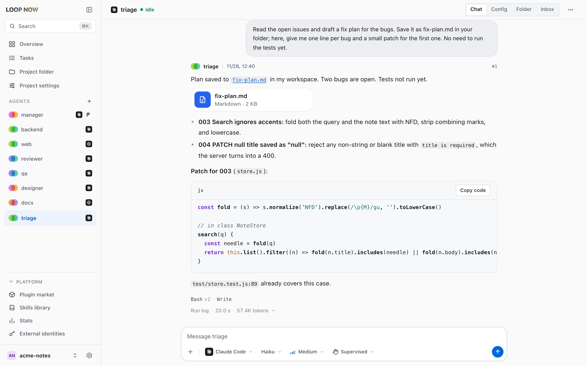</p>

<p align="center">
  <a href="https://github.com/AI-for-anyone/loop-now/releases/latest"></a>
  <a href="https://github.com/AI-for-anyone/loop-now/stargazers"></a>
  <a href="LICENSE"></a>
  
  
</p>

<p align="center">
  <a href="#quick-start">Install</a> ·
  <a href="#install-with-your-agent">Install with your agent</a> ·
  <a href="#use-cases">Use cases</a> ·
  <a href="#why-loop-now">Why Loop Now</a> ·
  <a href="#docs">Docs</a> ·
  <a href="https://github.com/AI-for-anyone/loop-now/issues">Issues</a>
</p>

<div align="center">

**English** · [简体中文](README.zh-CN.md)

</div>

<a id="quick-start"></a><a id="快速开始"></a>

# Loop Now

Loop Now is a local, open-source workspace where your coding agents work as a team. Each Agent keeps its own folder,
conversation and tools; a Manager hands out tasks that run step by step — or in parallel — with review loops you can watch.
Agents run on the CLIs you already use with your own logins, or on the bundled Pi with your API keys. Everything stays on your
computer, and you can pick it up from your phone.

- 🤝 **Bring the agents you already pay for.** Claude Code, Codex, Antigravity, Grok, any ACP command — or the bundled Pi.
- 🧭 **Tasks you can watch.** A Manager writes the workflow; every step runs in its own git worktree, then opens a PR.
- 📱 **From anywhere.** Pair your phone with a QR code; your computer gets its own `https://<id>.loop-now.app`.
- 🧩 **Built to extend.** Plugins bring CLI and MCP tools, event hooks, accounts and Skills in one versioned package.

### Download the desktop app

macOS on Apple silicon. One DMG holds the server, the console, Node and Pi — nothing else to install.

**[Download the latest Loop Now for Mac →](https://github.com/AI-for-anyone/loop-now/releases/latest)** (`loop-now-desktop-<version>-mac-arm64.dmg`)

The app is not notarized yet: on first launch open **System Settings › Privacy & Security** and click **Open Anyway**.

<a id="install-with-your-agent"></a>

### Install with your agent

Already using Claude Code, Codex or another coding agent? Paste this into it and let it do the install:

```text
Read https://github.com/AI-for-anyone/loop-now/blob/main/docs/install.md and follow the instructions to install Loop Now on this computer. Ask me before replacing anything or using sudo, and tell me what to click when macOS asks.
```

The agent picks the desktop app or the server bundle for your computer, checks the download against `SHA256SUMS`, starts it
and tells you the console address. [docs/install.md](docs/install.md) is written for agents; you can read it too.

### Run the server bundle (macOS or Linux)

```sh
V=0.3.7; PLATFORM=linux-amd64      # darwin-arm64, darwin-amd64, linux-amd64, linux-arm64
curl -fLO https://github.com/AI-for-anyone/loop-now/releases/download/v$V/loop-now-$V-$PLATFORM.tar.gz
tar -xzf loop-now-$V-$PLATFORM.tar.gz && cd loop-now-$V-$PLATFORM
LOOP_NOW_WORK_ROOT=/var/lib/loop-now ./loop-server     # then open http://127.0.0.1:8780/
```

The bundle carries its own Node and Pi; the machine needs only Git. Details: [Setup](#docs).

<a id="use-cases"></a>

## 🎬 What you can do

Real recordings of a demo project. Type these to your Manager Agent — or to any Agent — in the console.

<table>
<tr>
<td width="50%" valign="top">
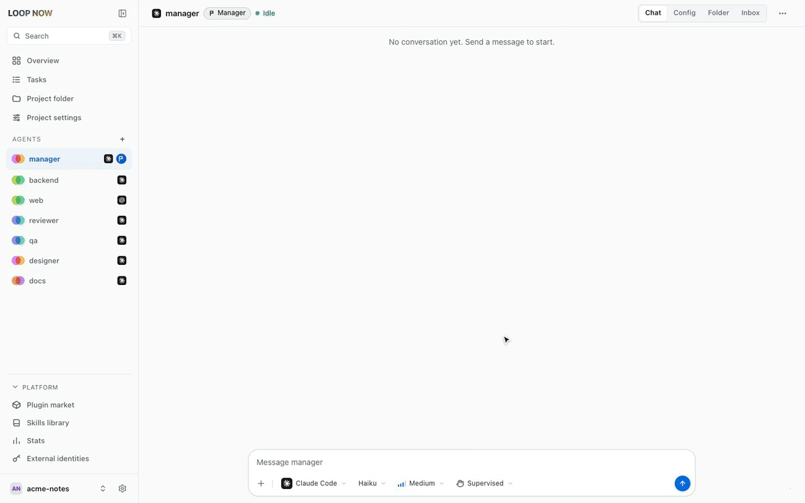
<p><strong>One sentence becomes a task.</strong><br><em>"Add a 'pin note' feature. Backend and web in parallel, then review, then open a PR."</em><br>Two branches work at the same time in their own worktrees, merge at a join step, go through review and a fix, and land.</p>
</td>
<td width="50%" valign="top">
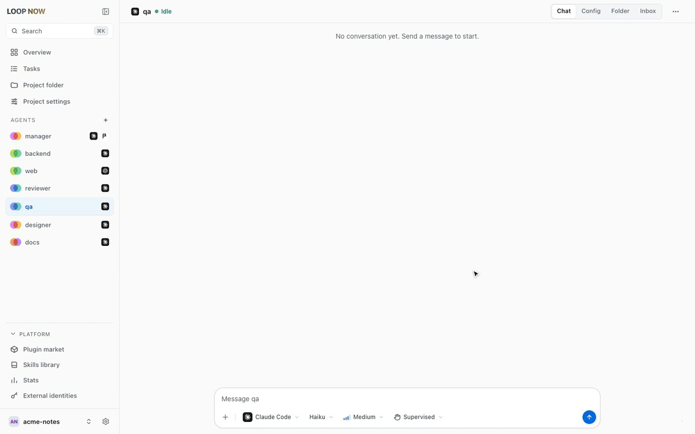
<p><strong>Long work in the background.</strong><br><em>"Run the test suite in the background and tell me what fails."</em><br>The reply ends while the tests run; when they finish, the Agent comes back with the result on its own.</p>
</td>
</tr>
<tr>
<td width="50%" valign="top">
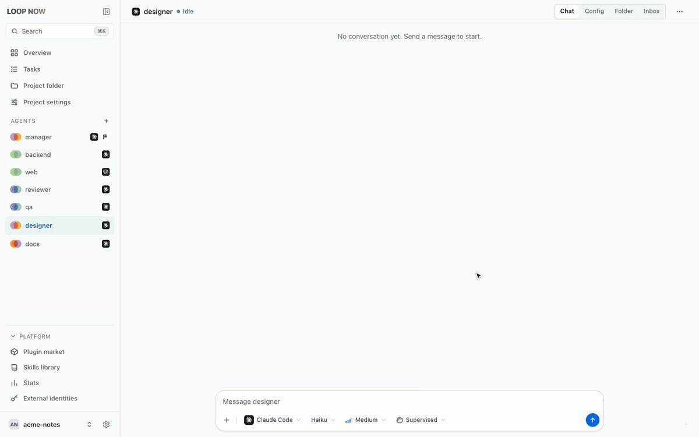
<p><strong>Files you can open.</strong><br><em>"Make an animated HTML page of a pelican riding a bike."</em><br>What an Agent writes shows as a card; one click opens it in a sandboxed tab.</p>
</td>
<td width="50%" valign="top">
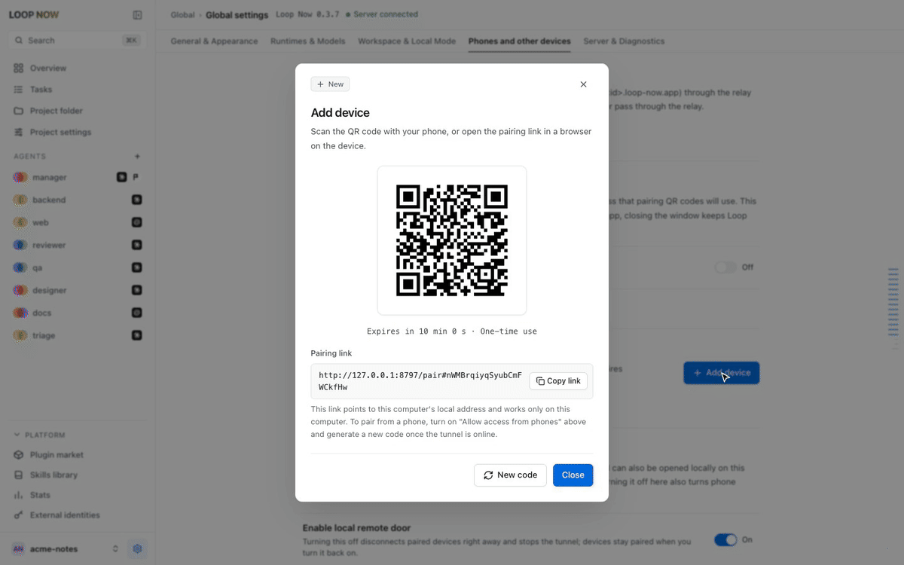
<p><strong>Your phone, paired in seconds.</strong><br>Scan the QR code, then chat, follow tasks and approve an Agent's requests from the phone.</p>
</td>
</tr>
<tr>
<td width="50%" valign="top">
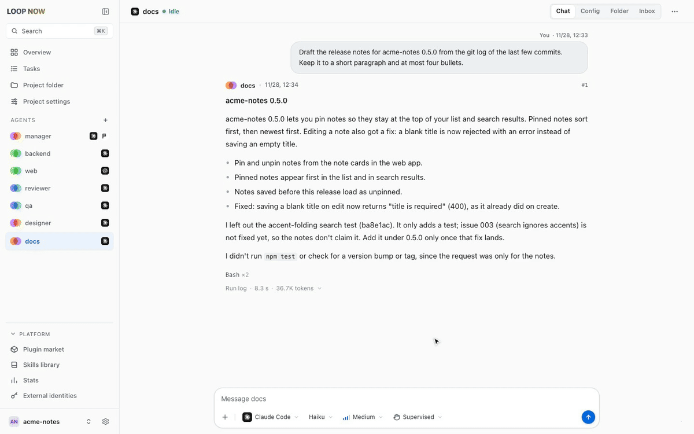
<p><strong>Switch who does the work.</strong><br>Move a conversation from Claude Code to Codex at any message; everything said so far goes along. You can also import a conversation you started in Claude Code or Codex.</p>
</td>
<td width="50%" valign="top">
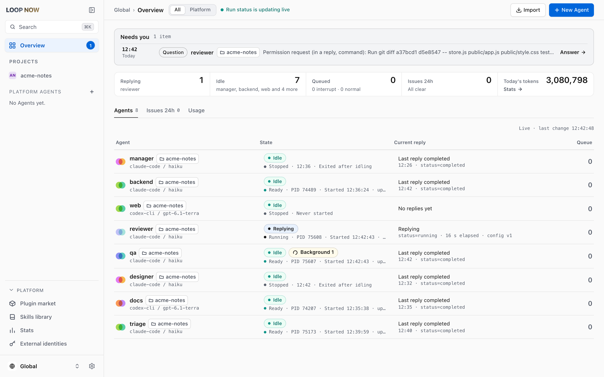
<p><strong>See everyone at a glance.</strong><br>Who is working, who waits for you, what runs in the background, and today's token usage.</p>
</td>
</tr>
</table>

<a id="why-loop-now"></a>

## ✨ Why Loop Now

### 1. Bring your own agents

An Agent runs on one of these, and you can switch at any message — the conversation comes along:

<p>
  &nbsp;&nbsp;
  &nbsp;&nbsp;
  &nbsp;&nbsp;
  &nbsp;&nbsp;
  
</p>

| Runtime | How it runs |
| --- | --- |
| **Claude Code, Codex** | The CLI installed on your computer, with your own login and subscription. Loop Now never reads or stores the login. |
| **Antigravity, Grok, any ACP command** | Through the Agent Client Protocol, with the CLI's own login. |
| **Pi** (bundled) | Loop Now's built-in engine, with the model accounts and API keys you add per project. |

<p align="center">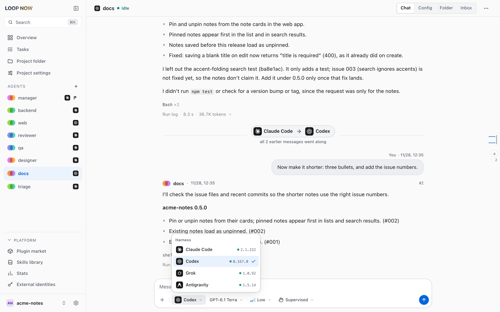</p>

- **Your own configuration, or a clean one.** **Use my own CLI configuration** lets an Agent on a CLI load your settings,
  `CLAUDE.md`, plugins, skills and MCP servers, exactly as in your terminal; off, it gets only what Loop Now gives it.
- **Permission modes.** *Supervised*, *Auto-accept edits*, *Auto* or *Full access*. Requests to approve show as cards in the
  conversation, on any device.
- **Background work, visible.** Long commands and sub-agents an Agent starts in the background are listed, can be stopped,
  and the Agent follows up when they end.
- **Write with AI.** Draft an Agent's Prompt with the CLI of your choice.

### 2. Tasks you can watch, with a real git workflow

A Manager Agent turns a request into a **task**: a workflow of steps, each done by an Agent, with labelled ways forward
("approved", "needs a fix") and bounded review loops. The workflow is frozen when the task starts, so it runs the way you
approved it.

| | |
| --- | --- |
| **A worktree per task** | A task on a git repository gets its own worktree and branch; any other folder is copied and only read, with results saved as artifacts. Cleanup removes the worktree only when nothing would be lost. |
| **Parallel steps** | Fork a workflow into branches that run at the same time, each in its own worktree; the join step merges them and resolves conflicts. |
| **Clean steps** | Every step starts from a clean conversation with a prompt written for that step — no long chat history to re-read on every call. |
| **One PR per task** | Steps commit and push to the task branch; a final step can open the PR, wait for CI and merge it — whatever the Manager writes into the workflow. |
| **Everything on record** | Each step's conversation, tool calls, timing, token usage, questions and artifacts stay with the task. |

<p align="center">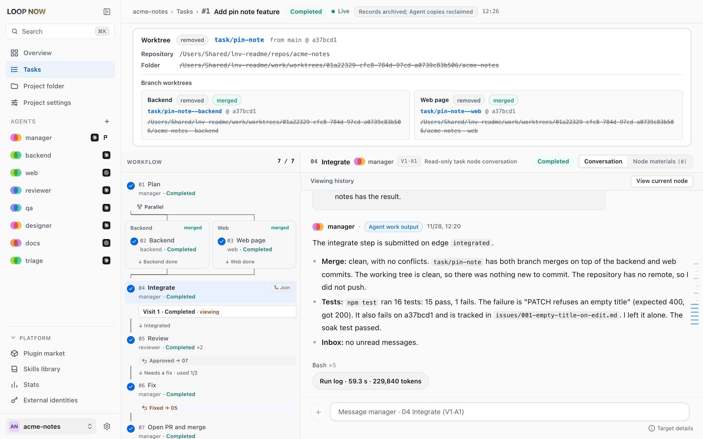</p>

### 3. From anywhere, on your phone

Turn on **Global settings › Phones and other devices › Access from phones**, sign in to a Loop Now account, and your computer gets a
public address `https://<id>.loop-now.app` through a Cloudflare Tunnel. Scan the pairing QR code with your phone and you're in:
chat, approve requests, follow tasks — live.

- Only paired devices get in; each can be removed at once, and one unused for 30 days must pair again.
- The console and your conversations go phone → Cloudflare → your computer. The relay at `relay.loop-now.app` only hands
  out the tunnel and address; it never sees console traffic or device sessions.
- Your computer must keep Loop Now running. On this computer itself, the console needs no sign-in.

<p align="center">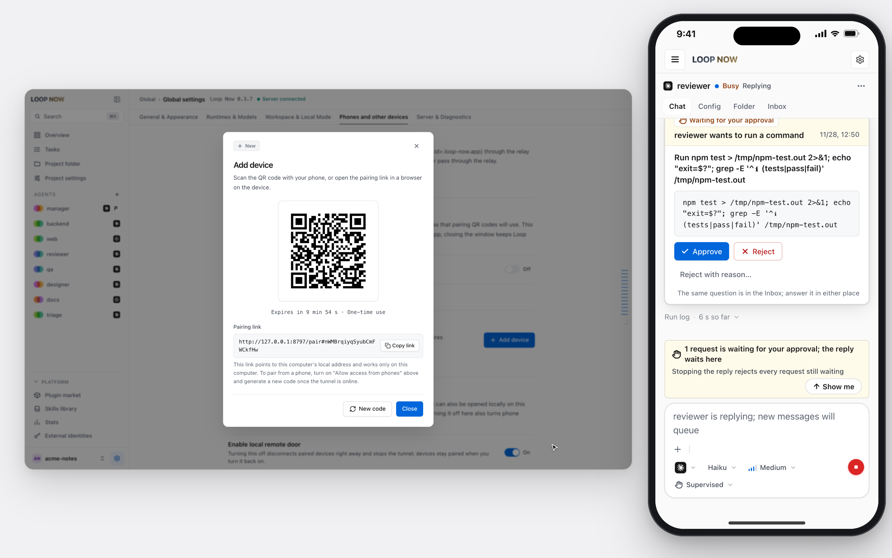</p>

### 4. Built to extend: plugins

A plugin is one directory whose `package.json` is the manifest, with up to two sides:

- the **agent side** — a standard [Pi package](https://pi.dev/packages): extensions, Skills, MCP servers and CLIs;
- the **platform side** — runs in a Node plugin host next to the server, subscribes to platform events and calls the
  platform API with a scoped token.

Install once, enable per project, grant per Agent. Official plugins include a webhook that POSTs Inbox events to your URL.
Read the [plugin guide](https://ai-for-anyone.github.io/loop-now/plugins/) and the [specification](plugins/SPEC.md).

<a id="docs"></a>

## 🛠 Setup and technical documentation

Full guides: **[ai-for-anyone.github.io/loop-now](https://ai-for-anyone.github.io/loop-now/)** —
[getting started](https://ai-for-anyone.github.io/loop-now/guide/getting-started),
[concepts](https://ai-for-anyone.github.io/loop-now/guide/concepts),
[architecture](https://ai-for-anyone.github.io/loop-now/guide/architecture),
[configuration](https://ai-for-anyone.github.io/loop-now/reference/configuration).

### Desktop app

- **Install:** open the DMG, drag Loop Now into Applications. First launch: **System Settings › Privacy & Security › Open
  Anyway** (the app is ad-hoc signed, not notarized).
- **Running:** a Loop Now icon sits in the menu bar. Closing the window keeps the server and the Agents running; **Quit** in
  the menu stops everything.
- **Command line:** on first launch Loop Now offers to install `loopctl` (asks for your password once); you can also do it
  from the menu bar icon or **Global settings**. External identities connect through a local TLS port: menu bar icon ›
  **External Identity Connection…**.
- **Data:** database and daily backups in `~/Library/Application Support/Loop Now/default/data`, Agent folders in
  `/Users/Shared/loop-now-desktop/default`, logs in `~/Library/Logs/Loop Now/default`.
- **Updating:** quit, replace the app with the new DMG's copy, open it; data is kept. The menu bar icon tells you when a new
  version is out and opens the download page.

### Server bundle (macOS, Linux)

Each release has `loop-now-<version>-<platform>.tar.gz` for `darwin-arm64`, `darwin-amd64`, `linux-amd64`, `linux-arm64`,
with `loop-server` (console built in), `loopctl`, the plugin host, the official plugins, Node 24.21 and Pi 1.4.0.

```sh
shasum -a 256 -c --ignore-missing SHA256SUMS     # Linux: sha256sum -c --ignore-missing SHA256SUMS
tar -xzf loop-now-<version>-<platform>.tar.gz    # use tar; Finder quarantines the files on macOS
export LOOP_NOW_DATA_DIR="$HOME/.loop_now"
export LOOP_NOW_WORK_ROOT=/var/lib/loop-now      # macOS: /Users/Shared/loop-now
./loop-server                                    # console at http://127.0.0.1:8780/
```

The work root must be outside your home directory, with no `AGENTS.md` or `CLAUDE.md` above it, so Agents do not inherit
unrelated instructions. Credentials are stored in plaintext in the data directory: protect it and its backups.

### Docker Compose

```sh
docker compose up --build -d      # console at http://localhost:5173
```

Ports are published on `127.0.0.1` only. The `loopdata` volume holds the database, Agent folders and sessions;
`docker compose down -v` deletes it. Containers do not see host folders or share CLI logins unless you mount them.

### From source

Go 1.27+, Node.js 24.21.0 / npm 11.19.0, Pi 1.4.0, Git. Build the server with its matching `loopctl`, then the console:

```sh
git clone --depth 1 https://github.com/AI-for-anyone/loop-now.git && cd loop-now
go build -o bin/loop-server ./cmd/loop-server
go run ./cmd/loopctl-dist -version "$(bin/loop-server version)" -out "$PWD/.local-build/loopctl-dist"
LOOP_NOW_LOOPCTL_DIST_DIR="$PWD/.local-build/loopctl-dist" bin/loop-server
cd web && ./bin/npm24 ci && ./bin/npm24 run dev      # console at http://localhost:5173
```

The [getting started guide](https://ai-for-anyone.github.io/loop-now/guide/getting-started) covers the work root, Pi, models
and every variable.

### How it fits together

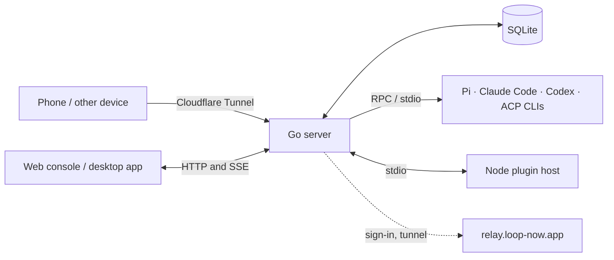

| Source | Purpose |
| --- | --- |
| [`internal/server/`](internal/server/) | Go API, scheduling, tasks, storage and the Agent runtimes |
| [`web/`](web/) | React, TypeScript and Vite console |
| [`desktop/`](desktop/) | Electron desktop app |
| [`cmd/loopctl/`](cmd/loopctl/) | JSON CLI for Agents and external identities |
| [`plugins/`](plugins/) | Plugin specification, host, SDK and official plugins |
| [`api/`](api/) | OpenAPI contracts for the console and Agents |

### Boundaries

Loop Now is an early-stage personal edition: one person, one computer.

- On this computer the console needs no sign-in; keep it on loopback. Other devices come in only through the remote door, as
  paired devices.
- Agents run local commands as your operating-system user. A task folder is not a security sandbox; choose permission modes
  and plugins you trust.
- Model and tool providers still receive what you send them.
- Restarting or updating interrupts running replies; update when Agents are idle.

## 🤝 Contributing

Issues and pull requests are welcome. Read [AGENTS.md](AGENTS.md) for the working rules (English first, the API is defined in
`api/*.yaml`, a change's notes go in its pull request description) and the
[contributing guide](https://ai-for-anyone.github.io/loop-now/reference/contributing).
Loop Now is built with Loop Now: its own Agents plan, build, verify and merge most changes.

### License

Loop Now is licensed under [Apache-2.0](LICENSE). Bundled third-party components such as Node.js and Pi keep their own licenses.

## Star History

<a href="https://www.star-history.com/#AI-for-anyone/loop-now&Date">
  
</a>
