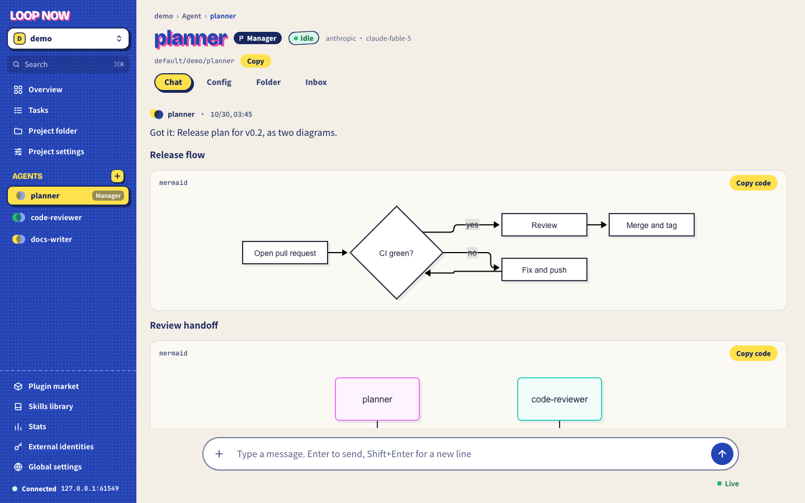
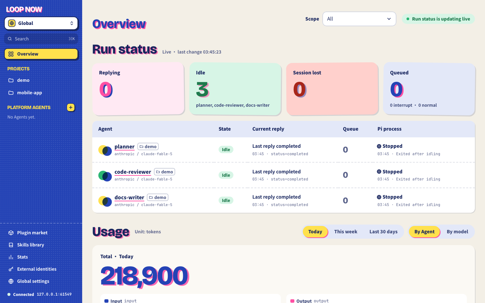
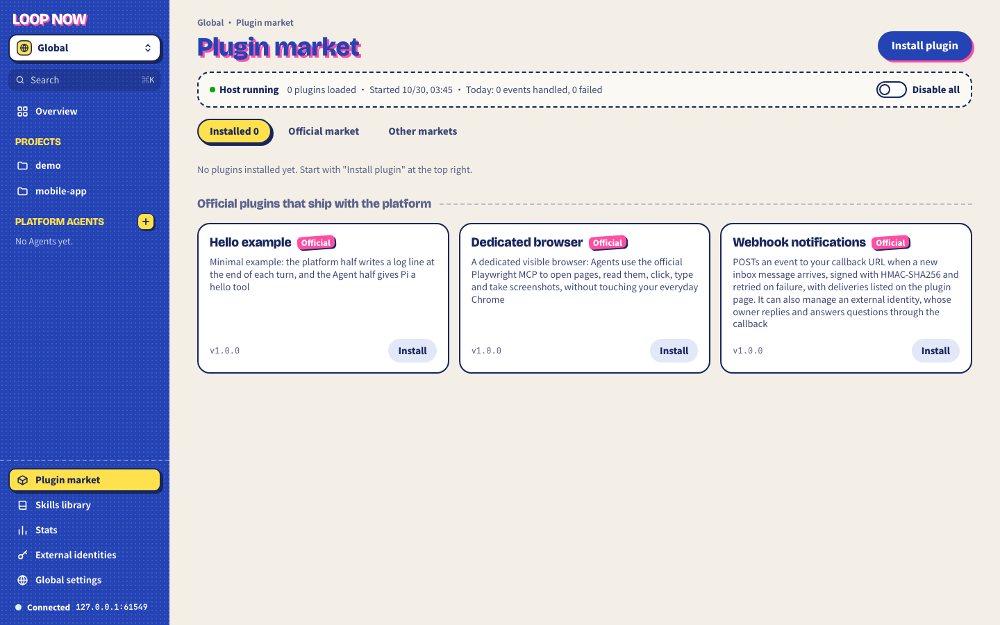
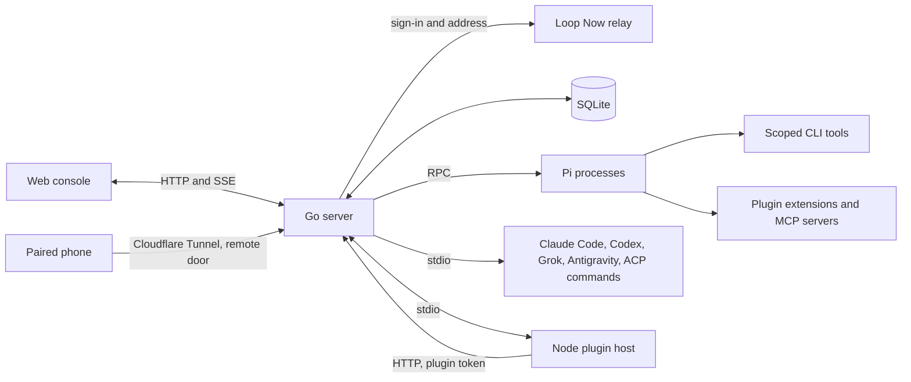

<p align="center">
  
</p>

<h1 align="center">Loop Now</h1>

<p align="center">
  <strong>A local multi-agent workspace, built to extend with plugins.</strong><br />
  Connect CLI and MCP tools, subscribe to events, and shape how your agents work—while keeping projects, conversations, and tasks in one place.
</p>

<p align="center">
  <a href="README.md">English</a> · <a href="README.zh-CN.md">简体中文</a><br />
  <a href="https://github.com/AI-for-anyone/loop-now/releases/latest">Download the desktop app</a> ·
  <a href="#getting-started">Getting started</a> ·
  <a href="#what-you-can-do">Features</a> ·
  <a href="#built-to-extend-the-plugin-system">Plugins</a> ·
  <a href="https://github.com/AI-for-anyone/loop-now/issues">Issues</a>
</p>



<p align="center"><sub>Actual console with demonstration data. The interface supports English and Chinese; it follows your browser language, or switch in Global settings.</sub></p>

Loop Now brings your agents into one browser workspace. An agent keeps its own working directory and conversation; a Manager can coordinate specialists through a task workflow. You can follow the conversation, inspect tool calls, send a message, approve what an agent asks to do, and see who is working or waiting.

**Plugins are the main extension point:** tools, event hooks, accounts, permissions, and resources can travel together as a versioned package.

The platform runs on your computer. Each agent runs on the bundled [Pi](https://github.com/earendil-works/pi), or on a coding CLI already installed here (Claude Code, Codex, Grok, Antigravity, or any program that speaks the Agent Client Protocol) with your own login. You choose the models, credentials, repositories, and tools each agent may use, and a paired phone can reach the same console from anywhere.

> **Early-stage personal edition.** One person, one local server. The console on this computer needs no login; phones and other devices get in only after pairing. Model and tool providers may still receive data when you use their services.

## What you can do

| Capability | What it gives you |
| --- | --- |
| **Build a team** | Organize agents by project. Give each a runtime and model, thinking level, Prompt (drafted with **Write with AI** if you like), Skills, folders, and tool access. Designate a Manager to coordinate the project. |
| **Use the CLIs you already have** | Run an agent on Claude Code, Codex, Grok, Antigravity, an ACP command you add, or the bundled Pi. Switch at any message; the conversation carries over. |
| **Stay in control** | Give each agent a permission mode, from Supervised to Full access, and approve or reject its requests in the reply, the Inbox, or a desktop notification. |
| **Keep work in context** | Continue an agent's regular conversation in its own workspace or a folder you pick. Import your Claude Code and Codex conversations and carry on. Work a CLI moves to the background stays visible and can be stopped. |
| **Coordinate through Inbox** | Agents and people exchange messages, ask questions, and reply. Choose queue or interrupt when an agent is busy; sleeping agents can wake when messages arrive. |
| **Run visible workflows** | Follow task steps, conditional branches, bounded review loops, parallel branches that meet at a join, retries, and saved artifacts. A task can work in its own git worktree and branch, or in a copy of any folder. |
| **Reach it from your phone** | Pair a phone with a one-time QR code. Sign this computer in to a Loop Now account and it gets `https://<id>.loop-now.app` through a Cloudflare Tunnel, with no router setup. |
| **Extend through plugins** | Bring CLI and MCP tools, event hooks, accounts, permissions, and Skills into one package. Add the integrations your team needs. |
| **See what happened** | Stream replies, send images, render Markdown and Mermaid, open the pictures and files an agent names, and inspect model usage, tool commands, timing, and failures in each reply's run timeline. |



### An example: from implementation to review

Create a Manager, a Developer, and a Reviewer. Pick who runs each one, their models, and their allowed tools, then ask the Manager to coordinate a change:

> Implement this feature in ~/projects/app, have the Reviewer check it, and open a pull request. Ask me through Inbox if a decision is needed.

Because the request names a repository, the Manager can give the task its own git worktree on a new branch, so your checkout is left alone. The workflow moves from development to review and back for a bounded number of revisions; you can inspect each step's conversation, messages, and artifacts throughout. Your project instructions and Skills define the actual process—the platform does not prescribe a particular coding, QA, or deployment policy.

## Working with agents

### Who runs an agent

Every agent runs on one runtime. Choose it with the **Runs on** picker when you create the agent, on its config page, or in the message box:

| Runtime | What it uses |
| --- | --- |
| **Pi** (bundled) | The model accounts and API keys you add in Loop Now (project settings › Model accounts), the [native `models.json`](#native-modelsjson), and model providers that come from plugins |
| **Claude Code**, **Codex**, **Grok**, **Antigravity** | The CLI installed on this computer and your own login there. Loop Now neither reads nor stores the login |
| **ACP commands you added** | Any program that speaks the Agent Client Protocol, added under **Global settings › Runtimes & Models**. It runs as the server's user, so add only programs you trust |

- **Global settings › Runtimes & Models** shows whether each CLI was found, its version, and whether it is logged in, with the command to install it or log in when it is not ready. Loop Now never runs those commands for you.
- A choice made in the message box applies from the next message, even while the agent is replying. Changing the runtime does not start over: the new runtime gets the saved conversation (all of it when it is short; otherwise your first request, the latest messages, and a line per turn about tool use, up to 16,000 tokens by default, `LOOP_NOW_CONTEXT_HANDOFF_TOKENS`).
- **Working folder** (config page › How it works): an agent on a CLI can work in a folder you pick instead of the workspace Loop Now gives it. Pi cannot.
- **Use my own CLI configuration** (Claude Code and Codex): the CLI runs as it does in your terminal, with this computer's HOME and PATH and your own git, gh, and ssh logins; on Claude Code also your settings, `CLAUDE.md`, auto memory, plugins, skills, MCP servers, and all of its built-in tools. Project accounts then no longer apply to the agent. Codex reads your `~/.codex` configuration either way.
- **Write with AI**, next to every Prompt, drafts the text with a CLI on this computer and its own login (**Global settings › Runtimes & Models › Writing with AI** says which one; by default the first one ready). Nothing is saved until you save, and no agent is created.
- **Local mode** (**Global settings › Workspace & Local Mode**) has four switches that apply to every agent: "Bind local directories" tells agents about the local directories you register on a project or an agent, "Use local git identity" pulls with this computer's git credentials, "Use local CLIs" lets agents run the commands installed here, and "Use local logins" gives them your own logins for those tools. "Use local logins" is off by default; with it on, agents act as you.

### Permission modes and approvals

- Every agent has a permission mode: **Supervised** (asks before running commands and changing files), **Auto-accept edits**, **Auto** (the CLI's own review approves routine actions and asks about the rest), or **Full access** (asks nothing). Full access is the default. Choose it in the message box or on the config page; the default for new agents is in **Global settings › General & Appearance**.
- A request appears in the reply that asked, with Approve, Reject, and a reason; also in the Inbox and as a desktop notification, since agents also run when nobody is watching. Stopping the reply rejects what is still pending.
- Claude Code and Codex ask about every action their mode does not allow. Grok, Antigravity, and ACP commands decide by their own permission rules what to ask about, so some commands run without asking. Pi runs with Full access only.
- A task step uses its agent's mode as it was when the task started.

### Conversations

- **Import conversations** (**Global settings › General & Appearance**, the empty overview, or a project's local folders; it also opens by itself on a fresh install with no agents) lists the Claude Code and Codex conversations on this computer, grouped by folder. Each folder becomes a project and each conversation an agent that continues it in that folder, with your own CLI configuration. The original is never changed: the agent continues from a copy taken at import.
- **Background work:** when Claude Code, Codex, Grok, or Antigravity moves a command or a sub-agent to the background, the reply ends as the CLI ends it and the work stays visible. A shell mark with a count in the bar under the message box opens the list, with Stop and Stop all. When Claude Code, Grok, or Antigravity replies by itself after the work ends, that reply shows as a reply of its own; Codex does not reply by itself.
- **Pictures and files in replies:** a picture an agent puts in its reply, or names by its path inside the agent's folder, shows as a thumbnail you can open. Other files it names show as cards that open in a sandboxed new tab (in the system browser, in the desktop app). Paths outside the folder stay plain text.
- **Commands:** type `/` in the message box for the built-in session commands (`/session`, `/new`, `/compact`, `/reload`, `/copy`, `/export`, `/resume`; which ones work depends on the runtime) and, on Pi, the commands of its extensions and Skills as `/pi:<name>`.
- A reply cut off by a quit or a crash is remembered: the next time, the agent knows what it had done and where it stopped.

### Tasks: workflows, workspaces, and parallel steps

- Ask the project's Manager for a piece of work and it creates a task: a fixed workflow of steps, each done by an agent, with conditional branches, bounded review loops, retries, and saved artifacts. The workflow and the agents' configuration are fixed when the task starts. The task page shows the flow, each step's conversation, and its artifacts.
- **A clean start:** an agent's part in a task starts from a clean conversation with its Prompt, its instruction files and memory, the task request, and the prompt the Manager wrote for the step (on the task page under "Step prompt"), but not its regular chat history; it keeps that task conversation across its own steps. A step that needs the agent's chat can ask for a copy of it ("With conversation"). Creating a task does not wait for busy agents.
- **Workspaces:** the Manager can name a folder on this computer for the task. A folder in a git repository gets its own worktree on one new branch, from the remote's default branch (`task/<number>-<title>` unless the Manager names it); the agents commit, push, and open the pull request themselves. Any other folder is copied for the task and only read; results are saved as artifacts. Several tasks can work on one folder at once. At the end, Loop Now removes a worktree or copy only when nothing would be lost, and it never switches branches in or cleans your own checkout.
- **Parallel steps:** a step can fork into branches that run at the same time and meet at a join step, which starts once every branch has arrived. In a git task each branch works in its own worktree on its own branch, and the join merges them into the task's branch (a conflict goes to the join step's agent); in a copied folder each branch has its own copy and nothing is merged back. Forks cannot be nested.

### Phones and other devices

Everything is on one page, **Global settings › Phones and other devices**, and only this computer can change it:

1. **Sign in to Loop Now.** The sign-in page of the Loop Now relay (`relay.loop-now.app`) opens in your browser. This computer gets its own address, `https://<id>.loop-now.app`, kept for it even after you sign out.
2. **Allow access from phones.** Loop Now runs `cloudflared` (from your `PATH`, or a pinned version it downloads and checks) and keeps a Cloudflare Tunnel open from this computer to the remote door, a second listener on `127.0.0.1`. No router setup is needed, and the tunnel comes back by itself after a crash or a restart.
3. **Add device.** A QR code and a link carry a one-time code, valid for 10 minutes; open it on the phone and it is paired. The page lists the paired devices and removes them at once; a device unused for 30 days must pair again. The console can be added to a phone's home screen.

Requests from a phone travel through Cloudflare's network and the tunnel to this computer. The relay only signs this computer in and registers its address and tunnel; your conversations and device sessions never pass through it. This computer must keep Loop Now running: closing the desktop app's window keeps it running, quitting stops it, and a phone then shows that it cannot connect. Without an account, the remote door can still be turned on, but only this computer can reach it. Details: [Configuration › Phones and other devices](https://ai-for-anyone.github.io/loop-now/reference/configuration#phones-and-other-devices).

## Built to extend: the plugin system

**New tools and project-specific behavior belong in plugins.** A plugin is one directory whose `package.json` is the manifest. It has up to two sides, and either one is optional:

- The **agent side** is a standard [Pi package](https://pi.dev/packages): Pi extensions, Skills, MCP servers, and CLIs, loaded into the Pi process of each agent you grant. An existing Pi package installs unchanged.
- The **platform side** runs in one long-lived Node plugin host next to the server. It subscribes to platform events and calls the platform API with a scoped plugin token.

Agents on Claude Code, Codex, Grok, or Antigravity get the Skills and MCP servers of the plugins granted to them; Pi extensions, and the model providers they bring, load only on Pi.

| The host provides | What it means for a plugin |
| --- | --- |
| **Events** | Every observation event in the catalog: runs, tasks, nodes, Inbox, questions, sleep, agents, Pi processes, folders, plugins. Events are persisted, acknowledged after the handler returns, retried, and replayed after a restart. Interception, modification, and claim hooks have their own timeouts and fallbacks. |
| **State + secrets** | Per-plugin persistent state, global or per project. `x-secret` configuration fields are write-only in the console and masked in plugin logs. |
| **Configuration forms** | `loopNow.configSchema` is plain JSON Schema; the console renders it. Fields marked `x-scope: project` can be overridden per project. |
| **Reliable outbound HTTP** | The SDK's delivery library keeps a persisted queue, retries with backoff, signs requests with HMAC-SHA256, and writes a delivery log that the plugin page displays. |
| **Logs + isolation** | Each plugin's output lands in its own log. A plugin that throws, times out, or fails to load affects only itself. |

The manifest is authoritative. Subscribing to an event, or calling an API scope, that the manifest does not declare fails, and install shows the user both sides, the events, and the permissions before anything runs.

Observation events, state, secrets, configuration, and the delivery library are available now. Interception and modification hooks, console action buttons, HTTP endpoints, schedules, channels, and plugin accounts are specified in [`plugins/SPEC.md`](plugins/SPEC.md) and are being rolled out.

### Install once, enable per project, grant per agent

Install from the official plugins, a Git repository, an npm package, or a local directory, in the console or with `loopctl plugin install`. Next, enable the plugin in a project and fill in its configuration. Then grant it to the agents that should load its agent side. Installing or enabling a plugin never authorizes an agent by itself. Versions are pinned: updating is an explicit action, and running tasks keep the files they started with.

A Pi extension can also bring a model provider with its own subscription login, such as the community extension pi-grok-cli from the plugin market: grant the plugin to the agent, log in under project settings › Model accounts (or on the agent's own page for an agent outside any project), and choose the provider in the agent's config.

Three official plugins ship with the platform:

- [**webhook**](plugins/official/webhook/README.md) POSTs `inbox.received` events to your URL with a signature, retries, and a delivery log. External identities use it instead of polling their Inbox.
- [**playwright**](plugins/official/playwright/README.md) gives agents a dedicated, visible Chromium through the official Playwright MCP: open pages, read them, click, type, and take screenshots, without touching your everyday Chrome.
- [**hello**](plugins/official/hello/README.md) is the smallest plugin with both sides, and the starting point for writing your own.



### A platform side in a few lines

```ts
import { createDelivery, type PluginAPI } from '@loop-now/plugin-sdk'

export default function register(api: PluginAPI) {
  const delivery = createDelivery(api)
  api.on('task.completed', async (event) => {
    const { url } = api.config.get<{ url?: string }>(event.projectId)
    if (url) await delivery.deliver({ target: url, body: event, eventId: event.id, eventType: event.type })
  })
}
```

```json
{
  "name": "task-notifier",
  "version": "1.0.0",
  "keywords": ["loop-now-plugin"],
  "peerDependencies": { "@loop-now/plugin-sdk": "*" },
  "loopNow": {
    "id": "task-notifier",
    "platform": "./platform.ts",
    "events": ["task.completed"],
    "permissions": ["state"],
    "configSchema": { "type": "object", "properties": { "url": { "type": "string", "x-scope": "project" } } }
  }
}
```

The host loads TypeScript directly, as Pi does, and provides `@loop-now/plugin-sdk` itself. Check a directory with `node plugins/host/dist/main.js validate <dir> --load`, which reports manifest errors and any subscriptions the code makes outside `loopNow.events`.

Start with the [SDK reference](plugins/sdk/README.md) and the official plugins. [`plugins/SPEC.md`](plugins/SPEC.md) is the full contract: package format, event catalog, hook kinds and timeouts, permissions, and installation. [`api/plugin-host-protocol.md`](api/plugin-host-protocol.md) describes the wire protocol between the server and the host. There is no sandbox: plugins execute code, so install sources you trust.

Lark user execution separately requires the pinned platform bundle described in [its build notes](scripts/lark-user-variant/README.md); it is not required for basic chat.

## Getting started

Four ways to run it: the **desktop app** (macOS, nothing to install), a **server release bundle** (Linux and macOS), **Docker Compose**, or a source installation. macOS Apple Silicon is the primary validated environment. Some components target Linux, but equivalent full-system coverage is not yet established; the Lark user CLI runtime is currently macOS arm64 only.

### Desktop app (macOS Apple Silicon)

One DMG carries the server, the console, Node and Pi; nothing else is required. Only this macOS Apple Silicon build is published; there is no Windows or Linux desktop app yet.

1. Download `loop-now-desktop-<version>-mac-arm64.dmg` from [Releases](https://github.com/AI-for-anyone/loop-now/releases/latest), open it and drag Loop Now into Applications.
2. First launch: the package is not yet notarized by Apple, so macOS says it cannot verify the developer. Open System Settings › Privacy & Security, find the Security section and click "Open Anyway"; the prompt does not return.
3. A Loop Now icon appears in the menu bar and the window shows the console. Closing the window keeps the server and the agents running in the background; choose "Quit Loop Now" from the menu bar icon to stop everything.

The menu bar icon shows the server's state and the profile in use, and offers Open Window, Open in Browser, Show Logs, Install Command Line Tool…, External Identity Connection…, and Restart Server.

Where the data lives: the database and daily backups are in `~/Library/Application Support/Loop Now/default/data`, agent workspaces in `/Users/Shared/loop-now-desktop/default`, logs in `~/Library/Logs/Loop Now/default`. By default the desktop app never touches the source installation's `~/.loop_now` or `/Users/Shared/loop-now`, so both can coexist. To try it with a separate data set, start it with a profile: `open -a "Loop Now" --args --profile=trial`. To move over from a source installation and keep its work root, stop the source installation's server, quit Loop Now, add `{"profiles": {"default": {"workRoot": "/Users/Shared/loop-now"}}}` to `~/Library/Application Support/Loop Now/desktop.json` (`dataDir` and `contextDir` can be set the same way, as absolute paths) and open it again; the profile line in the menu bar shows the paths in use. A PostgreSQL-based installation also needs its database imported first; [Getting started](https://ai-for-anyone.github.io/loop-now/guide/getting-started#moving-to-the-desktop-app) has the full steps.

Updating: quit Loop Now, replace the app in Applications with the new DMG's copy and open it again; data is kept. The app checks for new versions by itself (shortly after it starts, then every 6 hours); when one is out, the menu bar icon offers "Version … is available — Download…", which opens the download page. Automatic installation arrives once the app is signed and notarized.

The desktop app brings Pi 1.4.0 and Node 24.21; agents on Claude Code, Codex, Grok, or Antigravity use the CLI installed on this Mac. Model accounts, CLI accounts and plugins are configured in the console exactly as in a source installation. On first launch, Loop Now offers once to install the `loopctl` command line tool for your terminal (macOS asks for an administrator password once); you can also install it any time from the menu bar icon › "Install Command Line Tool…" or in **Global settings › General & Appearance › Command line tool (loopctl)**, which shows whether it is installed. The external TLS port used by external identities and `loopctl` is opened automatically on this computer only (`127.0.0.1`, with a self-signed certificate maintained by the server); menu bar icon › "External Identity Connection…" shows the address, certificate path and `loopctl` setup command.


### Server release bundle (Linux / macOS)

Each release also carries a server bundle per platform, `loop-now-<version>-<platform>.tar.gz` for `darwin-arm64`, `darwin-amd64`, `linux-amd64` and `linux-arm64`. It holds `loop-server` with the console built in, `loopctl`, the plugin host, the official plugins, and its own Node 24.21.0 and Pi 1.4.0, so the machine needs only Git.

1. Download your platform's bundle and `SHA256SUMS` from [Releases](https://github.com/AI-for-anyone/loop-now/releases/latest), then check the download:

   ```sh
   sha256sum -c --ignore-missing SHA256SUMS        # Linux
   shasum -a 256 -c --ignore-missing SHA256SUMS    # macOS
   ```

2. Unpack it with `tar` in a terminal. On macOS, unpacking it in Finder marks the files as downloaded from the internet, and Gatekeeper then blocks the unsigned binaries.

   ```sh
   tar -xzf loop-now-<version>-<platform>.tar.gz
   cd loop-now-<version>-<platform>
   ```

3. Set the data directory and the work root, then start the server. The work root follows the same rules as in a source installation and is created the same way ([step 2](#2-configure-the-server)):

   ```sh
   export LOOP_NOW_DATA_DIR="$HOME/.loop_now"
   export LOOP_NOW_WORK_ROOT='/var/lib/loop-now'   # macOS: /Users/Shared/loop-now
   ./loop-server
   ```

4. Open **[http://127.0.0.1:8780/](http://127.0.0.1:8780/)**. The console is served at the root of the server's port; there is no separate console process.

The bundled Node and Pi are used automatically, so there is nothing else to install; variables such as `LOOP_NOW_NODE_BIN` still take precedence when set. Credentials are stored in plaintext in the data directory; protect it and its backups. To update, stop the server, unpack the new bundle and start its `loop-server` with the same `LOOP_NOW_DATA_DIR` and `LOOP_NOW_WORK_ROOT`, then delete the old directory.


### Docker Compose (local all-in-one)

The first startup builds the server and console images locally, then starts both:

```sh
docker compose up --build -d
```

Open **[http://localhost:5173](http://localhost:5173)**. The local console has no login, so Compose publishes only Web port `5173` and API port `8780` on `127.0.0.1`. Do not expose this configuration externally.

The `loopdata` named volume stores the database (SQLite, with daily backups), agent workspaces, sessions, and tools. `docker compose down` preserves them; `docker compose down -v` deletes this data, so back it up first.

Agents running in containers have some boundaries:

- The Lark user CLI supports macOS arm64 only and is unavailable in these Linux containers.
- Containers do not automatically see host directories. Mount existing repositories or files into the `server` container separately, then configure the container paths in the console; `loopdata` stores only the platform's own workspaces.
- Containers do not share Pi or CLI login sessions from the host. Configure model API keys and required tool accounts in the project before starting work.
- The server image carries Pi only: Claude Code, Codex, Grok, and Antigravity are not installed in it, so agents in the container run on Pi.

### Native models.json

Go to **Global settings › Runtimes & Models › models.json** to edit the native `models.json` for the pinned Pi version, add custom providers, or override built-in providers. For example:

```json
{
  "providers": {
    "example": {
      "baseUrl": "https://models.example.com/v1",
      "api": "openai-completions",
      "apiKey": "$EXAMPLE_KEY",
      "headers": { "X-Client": "$EXAMPLE_CLIENT_HEADER" },
      "models": [
        { "id": "my-model", "input": ["text", "image"], "contextWindow": 128000, "maxTokens": 8192 }
      ]
    }
  }
}
```

`apiKey` and `headers` values on providers, models, and model overrides accept only `$NAME` environment-variable references. Names start with an ASCII letter or underscore, followed by letters, digits, or underscores. Plaintext secrets and `!commands` are rejected. Configure real credentials in project model accounts; they are not written to `models.json` or returned to the editor.

Persistent agents use the saved catalog from their next message, while running tasks keep the provider configuration frozen at creation. If a saved configuration no longer passes validation after a restart, the server temporarily falls back to the built-in catalog and shows a warning on the settings page so you can repair and save it.

### Source installation: 1. Prepare dependencies

| Dependency | Repository baseline |
| --- | --- |
| Go | 1.27 or later |
| Node.js / npm | **24.21.0 / 11.19.0**; Web scripts check these exact versions |
| Pi coding agent | **1.4.0** |
| Other tools | Git |

With the required Node and npm active:

```sh
npm install -g @earendil-works/pi-coding-agent@1.4.0
pi --version

git clone --depth 1 --branch main https://github.com/AI-for-anyone/loop-now.git
cd loop-now
```

### 2. Configure the server

Run the following from the repository root:

```sh
export LOOP_NOW_NODE_BIN="$(command -v node)"
export LOOP_NOW_PI_BIN="$(command -v pi)"
```

The server keeps its database and daily backups in a data directory, `~/.loop_now` of the server user by default (`LOOP_NOW_DATA_DIR` changes it); it creates the database on first start. Credentials are stored in plaintext in that database; protect the data directory and its backups. The server reads process environment variables; it does not automatically load an `.env` file.

Choose a persistent working directory **outside your home directory**, with no `AGENTS.md` or `CLAUDE.md` in its ancestor directories. This prevents Pi from inheriting unrelated host instructions. For a fresh installation, the default is `/Users/Shared/loop-now` on macOS or `/var/lib/loop-now` on Linux:

```sh
# macOS; on Linux use /var/lib/loop-now instead.
export LOOP_NOW_WORK_ROOT='/Users/Shared/loop-now'
sudo mkdir -p "$LOOP_NOW_WORK_ROOT"
sudo chown "$(id -u):$(id -g)" "$LOOP_NOW_WORK_ROOT"
chmod 700 "$LOOP_NOW_WORK_ROOT"
```

### 3. Build and start the backend

Build the server and its matching `loopctl` distribution together:

```sh
mkdir -p bin
go build -o bin/loop-server ./cmd/loop-server
loop_version="$(bin/loop-server version)"
go run ./cmd/loopctl-dist -version "$loop_version" -out "$PWD/.local-build/loopctl-dist"

export LOOP_NOW_LOOPCTL_DIST_DIR="$PWD/.local-build/loopctl-dist"
bin/loop-server
```

Startup checks dependencies, applies pending database migrations, and creates the default organization and project. The API listens on `127.0.0.1:8780`. A data directory serves one server at a time; when updating, preserve the data directory and the working directory. To move an installation from a PostgreSQL-based release (up to v0.1.0), first check out the tag `pg-final` (the last PostgreSQL-based commit), build it and start it once so the old database reaches its last migration, stop it, then run `loop-server import-postgres` with `LOOP_NOW_DATABASE_URL` pointing at the old database; it copies everything into a new database in the data directory.

Plugins need the Node plugin host, built from `plugins/` (Node 24.21.0). The server runs it only when `LOOP_NOW_PLUGIN_HOST_ENTRY` is set, and offers the official plugins as the `builtin` install source when `LOOP_NOW_PLUGIN_OFFICIAL_DIR` is set:

```sh
(cd plugins && npm ci --ignore-scripts && npm run build)
export LOOP_NOW_PLUGIN_HOST_ENTRY="$PWD/plugins/host/dist/main.js"
export LOOP_NOW_PLUGIN_OFFICIAL_DIR="$PWD/plugins/official"
```

Set these before starting `bin/loop-server`. `dist/main.js` is a single self-contained file and can be copied elsewhere. Optional tool integrations may require their own dependencies and credentials.

### 4. Start the console

In a second terminal, from the repository root, with Node 24.21.0 and npm 11.19.0 active:

```sh
cd web
export LOOP_NOW_WEB_NODE_BIN="$(dirname "$(command -v node)")"
./bin/npm24 ci
./bin/npm24 run dev
```

Open **[http://localhost:5173](http://localhost:5173)**. The default API address is already configured. For a different address, see [`web/.env.example`](web/.env.example).

### 5. Give your first agent a job

1. Create an Agent and choose who runs it. A CLI that is installed and logged in on this computer works at once; for Pi, first add a model account (a supported login or an API key) in the project settings. Already have Claude Code or Codex conversations? **Import conversations** turns them into agents instead.
2. Write its Prompt (or let **Write with AI** draft it) and add Skills.
3. Pick a working folder or add the repositories and files it needs, and choose its permission mode. Enable plugins and grant tool access explicitly.
4. Start a conversation. For images, choose a model that supports image input.
5. When you want collaboration, add specialist agents and designate a project Manager.

Start with one agent and a small task before adding a longer workflow.

## How it fits together



SQLite in the data directory stores platform state, credentials, messages, task records, and queues; busy locks and live streams are kept in the server process. The local filesystem holds agent workspaces, sessions, task worktrees and copies, and installed tools. Each agent's turns run in a Pi process or in the CLI the agent runs on; the CLIs keep their own conversation history and logins where they always do. These components form one local installation; the diagram does not imply independently scalable services.

| Source | Purpose |
| --- | --- |
| [`web/`](web/) | React, TypeScript, and Vite console |
| [`internal/server/`](internal/server/) | Go API, scheduling, storage, and local execution |
| [`cmd/loopctl/`](cmd/loopctl/) | JSON CLI for platform agents and external identities |
| [`plugins/`](plugins/) | Plugin specification, Node plugin host, SDK, and official plugins |
| [`api/`](api/) | Console and Agent OpenAPI contracts |
| [`MAIN.md`](MAIN.md) | Maintainer overview and current implementation state |

## Configuration and boundaries

All server options and defaults are defined in [`internal/server/config/config.go`](internal/server/config/config.go). Frequently adjusted settings include:

| Variable | Purpose / default |
| --- | --- |
| `LOOP_NOW_LISTEN_ADDR` | Console API; `127.0.0.1:8780` |
| `LOOP_NOW_DATA_DIR` | Database (`db/`) and daily backups (`backups/`); `~/.loop_now` of the server user |
| `LOOP_NOW_WORK_ROOT` | Persistent agent workspaces and runtime files |
| `LOOP_NOW_CONTEXT_DIR` | Shared project (`projects/<id>/`) and global (`global/`) context folders; `~/.loop_now` of the server user |
| `LOOP_NOW_PLUGIN_HOST_ENTRY` | Absolute path of the plugin host entry run with Node; unset means plugins' platform sides do not run |
| `LOOP_NOW_PLUGIN_OFFICIAL_DIR` | Absolute path of the official plugins shipped with the platform (one directory per plugin); unset means no `builtin` install source |
| `LOOP_NOW_PLUGIN_MARKET_URL` | `https` address of the official plugin market's `loop-now-market.json`; defaults to the official market index and can point elsewhere |
| `LOOP_NOW_PI_MAX_PROCESSES` | `0` means unlimited; a positive value caps local Pi processes |
| `LOOP_NOW_PI_IDLE_TIMEOUT` | Idle Pi process timeout; `10m` |
| `LOOP_NOW_CONSOLE_ORIGINS` | Cross-origin browser origins allowed to call the API, for the Vite dev server; local port 5173 by default. The console the server serves itself needs no entry |
| `LOOP_NOW_CONTEXT_HANDOFF_TOKENS` | How much of the saved conversation a new runtime gets when an agent changes runtime; `16000` |
| `LOOP_NOW_RELAY_URL` | The Loop Now relay for the account and the tunnel; `https://relay.loop-now.app` |
| `LOOP_NOW_CLOUDFLARED_PATH` | The `cloudflared` to run for the tunnel; unset looks on `PATH`, then downloads the pinned release |
| `LOOP_NOW_LARK_USER_BUNDLE_DIR` | Optional verified Lark user CLI bundle |

The current release is intended for trusted personal use:

- The console on this computer has no login. Keep its listener on loopback rather than exposing it to a network. Other devices come in only through the remote door, where every request needs a paired device; see [Phones and other devices](#phones-and-other-devices) and [Configuration › Phones and other devices](https://ai-for-anyone.github.io/loop-now/reference/configuration#phones-and-other-devices).
- Agents execute local commands under the server's operating-system user. A task directory, a worktree, or a permission mode is not an OS security sandbox. An agent on a CLI with your own configuration, or with "Use local logins" on, acts as you.
- Plugins and ACP commands you add execute code; install sources you trust. Model and tool access also depends on the credentials and permissions you provide.
- Workflows support linear steps, conditional branches, bounded loops, and parallel branches that meet at a join (not nested). Multi-replica deployment and elastic scaling are outside this edition's scope.
- Conversation history is persistent, but a server restart is not a promise of uninterrupted execution or automatic replay of in-flight work. Prefer updating when agents are idle.

## Contributing

Bug reports, small fixes, plugin integrations, and documentation improvements are welcome. For larger behavior changes, open an [issue](https://github.com/AI-for-anyone/loop-now/issues) first so the scope is clear.

Read [`AGENTS.md`](AGENTS.md) and [`MAIN.md`](MAIN.md), keep changes focused, and run the checks relevant to your changes:

```sh
# Backend (from the repository root)
go vet ./cmd/... ./internal/... ./api/...
go run ./scripts/check-english
go test ./cmd/... ./internal/... ./api/...

# Web (from web/, using the Node path configured above)
./bin/npm24 run typecheck
./bin/npm24 run api:check
./bin/npm24 run lint
./bin/npm24 run check:text
./bin/npm24 test
./bin/npm24 run build
```

Backend tests need no external services; each uses its own temporary data directory. Only the one-off PostgreSQL importer's tests need a test database through `LOOP_NOW_TEST_DATABASE_URL`. Native and browser tests have additional fixture requirements. A skipped integration test is not a successful integration run. Keep credentials, local runtime data, and build artifacts out of contributions.

## License

Copyright 2026 Loop Now contributors.

Loop Now is licensed under the [Apache License 2.0](LICENSE). Bundled third-party code and fonts retain their own licenses and notices.
