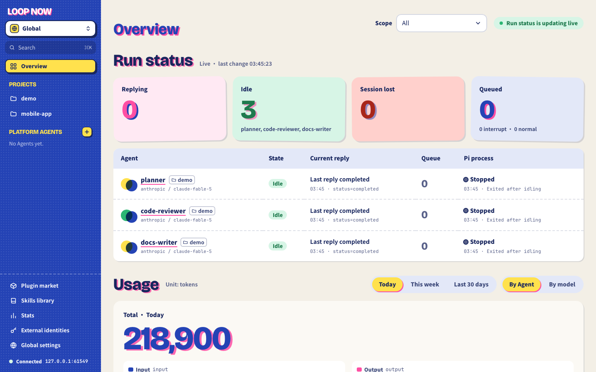
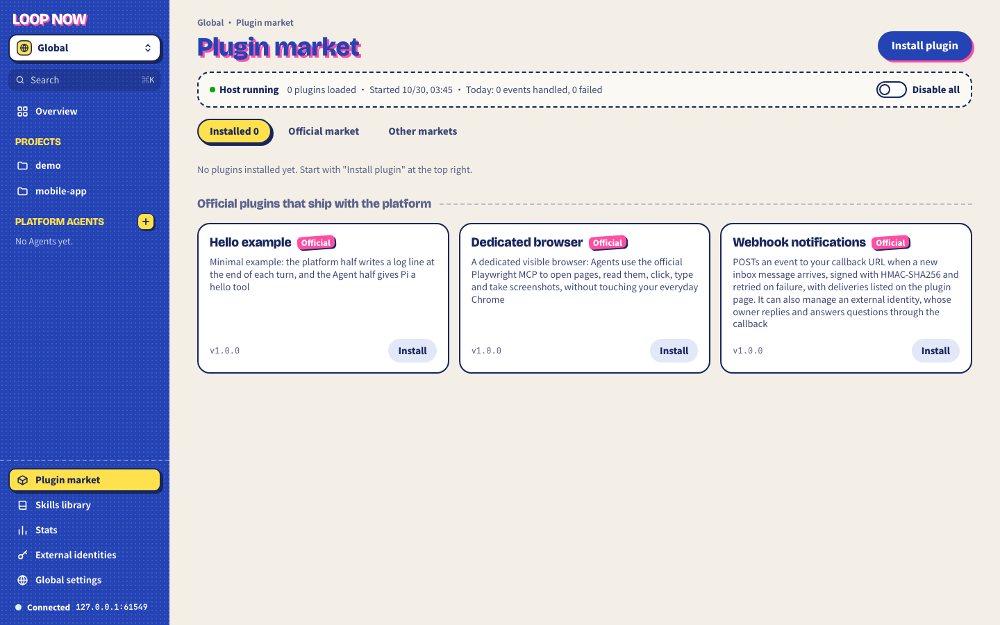
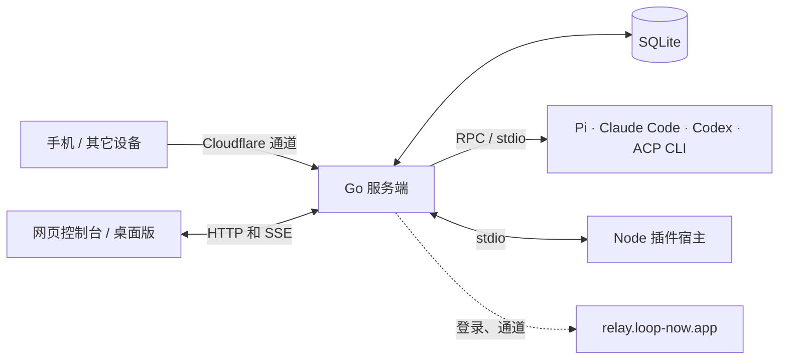

<p align="center"></p>

<p align="center"><strong>你的编程 Agent，一个工作台。Claude Code、Codex、Antigravity、Grok 和 Pi 一起干活——跑在你自己的电脑上，手机也能接着用。</strong></p>

<p align="center"></p>

<p align="center">
  <a href="https://github.com/AI-for-anyone/loop-now/releases/latest"></a>
  <a href="https://github.com/AI-for-anyone/loop-now/stargazers"></a>
  <a href="LICENSE"></a>
  
  
</p>

<p align="center">
  <a href="#快速开始">安装</a> ·
  <a href="#让-agent-帮你装">让 Agent 帮你装</a> ·
  <a href="#能拿它做什么">用法</a> ·
  <a href="#为什么用-loop-now">为什么用它</a> ·
  <a href="#文档">文档</a> ·
  <a href="https://github.com/AI-for-anyone/loop-now/issues">Issues</a>
</p>

<div align="center">

[English](README.md) · **简体中文**

</div>

<a id="快速开始"></a><a id="quick-start"></a>

# Loop Now

Loop Now 是一个跑在本机、开源的工作台，让你的编程 Agent 组成一个团队一起干活。每个 Agent 有自己的文件夹、对话和工具；
Manager 把活拆成任务，一步一步做，也可以几步同时做，中间的审查和返工你都看得见。Agent 用你已经在用的 CLI、用你自己的登录来跑，
也可以用自带的 Pi 加上你的 API Key。东西都留在你的电脑上，手机也能接着用。

- 🤝 **用你已经付过钱的 Agent。** Claude Code、Codex、Antigravity、Grok、任何 ACP 命令，或者自带的 Pi。
- 🧭 **看得见的任务。** Manager 写好流程，每一步都在自己的 git worktree 里做，最后提 PR。
- 📱 **在哪都能用。** 手机扫码配对，你的电脑会有自己的地址 `https://<编号>.loop-now.app`。
- 🧩 **能扩展。** 插件把 CLI 和 MCP 工具、事件钩子、账号和 Skills 打成一个有版本的包。

### 下载桌面版

适用于 Apple 芯片的 Mac。一个 DMG 里装着服务端、控制台、Node 和 Pi，别的都不用装。

**[下载最新版 Loop Now for Mac →](https://github.com/AI-for-anyone/loop-now/releases/latest)**（`loop-now-desktop-<版本>-mac-arm64.dmg`）

应用还没有经过苹果公证：第一次打开时，去 **系统设置 › 隐私与安全性**，点 **仍要打开**。

<a id="让-agent-帮你装"></a>

### 让 Agent 帮你装

已经在用 Claude Code、Codex 或别的编程 Agent？把下面这段话发给它，让它来装：

```text
阅读 https://github.com/AI-for-anyone/loop-now/blob/main/docs/install.md ，按里面的说明在这台电脑上安装 Loop Now。替换任何东西、或者要用 sudo 之前先问我；macOS 弹出提示时，告诉我该点哪里。
```

它会按你的电脑选桌面版还是服务端发行包，用 `SHA256SUMS` 核对下载的文件，启动起来，再告诉你控制台的地址。
[docs/install.md](docs/install.md) 是写给 Agent 看的，你也可以自己看。

### 运行服务端发行包（macOS 或 Linux）

```sh
V=0.3.7; PLATFORM=linux-amd64      # darwin-arm64、darwin-amd64、linux-amd64、linux-arm64
curl -fLO https://github.com/AI-for-anyone/loop-now/releases/download/v$V/loop-now-$V-$PLATFORM.tar.gz
tar -xzf loop-now-$V-$PLATFORM.tar.gz && cd loop-now-$V-$PLATFORM
LOOP_NOW_WORK_ROOT=/var/lib/loop-now ./loop-server     # 然后打开 http://127.0.0.1:8780/
```

发行包自带 Node 和 Pi，机器上只要有 Git。详细说明见 [安装和技术文档](#文档)。

<a id="能拿它做什么"></a>

## 🎬 能拿它做什么

下面是一些常交给 Loop Now 的活。在控制台里跟你的 Manager——或者任何一个 Agent——这么说就行。

| 你说 | 会发生什么 |
| --- | --- |
| *“加上用 GitHub 登录。后端和控制台同时做，然后审查，再提 PR，CI 过了就合并。”* | Manager 写一个任务：两个分支同时在各自的 worktree 里做，在汇合那一步合到一起；负责审查的 Agent 实际跑一遍检查结果；最后一步提 PR，CI 过了就合并。 |
| *“读一下还开着的 issue，给其中的 bug 写个修复计划。”* | 一个跑在 Claude Code 上的 Agent 用你自己的登录在仓库里干活，把计划写进它的文件夹；回复里显示成一张文件卡片，点一下就打开。 |
| *“接着我昨天在 Codex 里聊的那段对话做。”* | 把 Codex（或 Claude Code）的对话导入进来，Agent 接着聊，用原来的 CLI 或换一个都行。 |
| *“把完整的测试跑一遍，告诉我哪些挂了。”* | Agent 在后台跑；回复下面显示 `⟳ Bash 后台运行中`，跑完 Agent 会接着把结果告诉你——不管你在用哪台设备。 |
| *“给我做一个鹈鹕骑自行车的动画网页。”* | 文件显示成一张卡片，点一下就在一个隔离的新页面里打开。 |

<p align="center"></p>

<a id="为什么用-loop-now"></a>

## ✨ 为什么用 Loop Now

### 1. 用你自己的 Agent

一个 Agent 可以跑在下面任何一个上，每条消息都能换，对话会跟着过去：

<p>
  &nbsp;&nbsp;
  &nbsp;&nbsp;
  &nbsp;&nbsp;
  &nbsp;&nbsp;
  
</p>

| 跑在哪 | 怎么跑 |
| --- | --- |
| **Claude Code、Codex** | 用你电脑上装好的 CLI，用你自己的登录和订阅。Loop Now 不读、也不存你的登录信息。 |
| **Antigravity、Grok、任何 ACP 命令** | 通过 Agent Client Protocol，用这个 CLI 自己的登录。 |
| **Pi**（自带） | Loop Now 自带的引擎，用你在项目里加的模型账号和 API Key。 |

- **用你自己的配置，或者一份干净的。** 打开 **用我本机的 CLI 配置**，跑在 CLI 上的 Agent 会加载你的设置、`CLAUDE.md`、插件、
  Skills 和 MCP 服务，跟你在终端里一样；关着时，它只拿到 Loop Now 给的东西。
- **权限模式。** *逐项批准*、*改文件不用问*、*自动审查*、*完全放开*。要你批准的操作会以卡片出现在对话里，哪台设备上都能点。
- **后台的活看得见。** Agent 在后台开的长命令和子 Agent 都列出来，能停掉；跑完后 Agent 会接着说。
- **AI 帮写。** 用你选的 CLI 帮你起草 Agent 的 Prompt。

### 2. 看得见的任务，配上真正的 git 流程

Manager Agent 把一个请求变成一个**任务**：由若干步骤组成的流程，每一步由一个 Agent 做，往下走有带名字的路（“验证通过”“要改”），
返工的次数有上限。任务一开始流程就定死了，按你认可的样子跑。

| | |
| --- | --- |
| **一个任务一个 worktree** | git 仓库里的任务有自己的 worktree 和分支；别的文件夹会复制一份、只读，结果存成产物。收尾时只在不会丢东西的情况下才删 worktree。 |
| **并行步骤** | 流程可以分叉成几个分支同时跑，每个分支在自己的 worktree 里；汇合那一步把它们合起来，有冲突就在那一步解决。 |
| **干净的步骤** | 每一步都从一段干净的对话开始，带着专门为这一步写的 Prompt，不用每次都重读一大段聊天记录。 |
| **一个任务一个 PR** | 每一步都提交、推送到任务分支；最后一步可以提 PR、等 CI、合并——Manager 在流程里怎么写就怎么做。 |
| **全程有记录** | 每一步的对话、工具调用、耗时、token 用量、提问和产物都跟着任务留下来。 |

### 3. 在哪都能用，手机也行

打开 **全局设置 › 手机和其它设备 › 从手机访问**，登录一个 Loop Now 账号，你的电脑就会通过 Cloudflare 通道拿到一个公网地址
`https://<编号>.loop-now.app`。手机扫一下配对二维码就进来了：聊天、批准操作、看任务进度，都是实时的。

- 只有配对过的设备能进；每台设备都能随时移除，30 天没用的要重新配对。
- 控制台和你的对话走的是 手机 → Cloudflare → 你的电脑。`relay.loop-now.app` 这个中转服务只负责发通道和地址，
  看不到控制台的流量，也拿不到设备的登录。
- 你的电脑要一直开着 Loop Now。在这台电脑上打开控制台不用登录。

### 4. 能扩展：插件

一个插件就是一个文件夹，`package.json` 就是它的清单，最多有两边：

- **Agent 这边**：一个标准的 [Pi 包](https://pi.dev/packages)，可以带扩展、Skills、MCP 服务和 CLI；
- **平台这边**：跑在服务端旁边的一个 Node 插件宿主里，订阅平台事件，用一把限定范围的令牌调用平台 API。

装一次，按项目启用，按 Agent 授权。官方插件里有一个 webhook，把收件箱的事件 POST 到你的地址。
看 [插件指南](https://ai-for-anyone.github.io/loop-now/zh/plugins/) 和 [插件规范](plugins/SPEC.md)。

<p align="center"></p>

<a id="文档"></a>

## 🛠 安装和技术文档

完整文档：**[ai-for-anyone.github.io/loop-now/zh](https://ai-for-anyone.github.io/loop-now/zh/)**——
[快速开始](https://ai-for-anyone.github.io/loop-now/zh/guide/getting-started)、
[核心概念](https://ai-for-anyone.github.io/loop-now/zh/guide/concepts)、
[架构](https://ai-for-anyone.github.io/loop-now/zh/guide/architecture)、
[配置](https://ai-for-anyone.github.io/loop-now/zh/reference/configuration)。

### 桌面版

- **安装：** 打开 DMG，把 Loop Now 拖进“应用程序”。第一次打开：**系统设置 › 隐私与安全性 › 仍要打开**（应用只做了临时签名，
  还没经过公证）。
- **运行：** 菜单栏里有一个 Loop Now 图标。关掉窗口，服务端和 Agent 照样在后台跑；从菜单里选 **退出** 才会全部停掉。
- **命令行：** 第一次打开时 Loop Now 会问要不要安装 `loopctl`（要输一次电脑密码）；之后也可以从菜单栏图标或 **全局设置** 里装。
  外部身份通过一个只在本机的 TLS 端口连进来：菜单栏图标 › **外部身份连接方式…**。
- **数据：** 数据库和每天的备份在 `~/Library/Application Support/Loop Now/default/data`，Agent 的文件夹在
  `/Users/Shared/loop-now-desktop/default`，日志在 `~/Library/Logs/Loop Now/default`。
- **更新：** 退出，用新 DMG 里的应用替换掉旧的，再打开；数据都在。有新版本时菜单栏图标会提示，并打开下载页面。

### 服务端发行包（macOS、Linux）

每个版本都有 `loop-now-<版本>-<平台>.tar.gz`，平台有 `darwin-arm64`、`darwin-amd64`、`linux-amd64`、`linux-arm64`。
包里有 `loop-server`（内置控制台）、`loopctl`、插件宿主、官方插件、Node 24.21 和 Pi 1.4.0。

```sh
shasum -a 256 -c --ignore-missing SHA256SUMS     # Linux：sha256sum -c --ignore-missing SHA256SUMS
tar -xzf loop-now-<版本>-<平台>.tar.gz           # 用 tar 解压；在 macOS 上用访达解压会被隔离
export LOOP_NOW_DATA_DIR="$HOME/.loop_now"
export LOOP_NOW_WORK_ROOT=/var/lib/loop-now      # macOS：/Users/Shared/loop-now
./loop-server                                    # 控制台在 http://127.0.0.1:8780/
```

工作根目录要放在主目录之外，上层不能有 `AGENTS.md` 或 `CLAUDE.md`，免得 Agent 继承不相干的说明。登录凭据以明文存在数据目录里，
请保护好它和它的备份。

### Docker Compose

```sh
docker compose up --build -d      # 控制台在 http://localhost:5173
```

端口只发布在 `127.0.0.1` 上。`loopdata` 卷里有数据库、Agent 文件夹和会话；`docker compose down -v` 会把它删掉。
容器看不到宿主机的文件夹，也不共享宿主机上 CLI 的登录，除非你自己挂载进去。

### 从源码运行

需要 Go 1.27+、Node.js 24.21.0 / npm 11.19.0、Pi 1.4.0、Git。先构建服务端和配套的 `loopctl`，再起控制台：

```sh
git clone --depth 1 https://github.com/AI-for-anyone/loop-now.git && cd loop-now
go build -o bin/loop-server ./cmd/loop-server
go run ./cmd/loopctl-dist -version "$(bin/loop-server version)" -out "$PWD/.local-build/loopctl-dist"
LOOP_NOW_LOOPCTL_DIST_DIR="$PWD/.local-build/loopctl-dist" bin/loop-server
cd web && ./bin/npm24 ci && ./bin/npm24 run dev      # 控制台在 http://localhost:5173
```

工作根目录、Pi、模型和所有环境变量，见 [快速开始](https://ai-for-anyone.github.io/loop-now/zh/guide/getting-started)。

### 整体结构



| 目录 | 内容 |
| --- | --- |
| [`internal/server/`](internal/server/) | Go API、调度、任务、存储，以及各种 Agent 运行方式 |
| [`web/`](web/) | React、TypeScript 和 Vite 写的控制台 |
| [`desktop/`](desktop/) | Electron 桌面版 |
| [`cmd/loopctl/`](cmd/loopctl/) | 给 Agent 和外部身份用的 JSON 命令行 |
| [`plugins/`](plugins/) | 插件规范、宿主、SDK 和官方插件 |
| [`api/`](api/) | 控制台和 Agent 用的 OpenAPI 接口约定 |

### 使用边界

Loop Now 现在是早期的个人版：一个人，一台电脑。

- 在这台电脑上打开控制台不用登录；请只在本机访问。别的设备只能通过“远程入口”、以配对过的设备身份进来。
- Agent 以你的系统用户身份在本机执行命令。任务文件夹不是安全沙箱；请选你信得过的权限模式和插件。
- 模型和工具服务商仍然会收到你发给它们的内容。
- 重启或更新会打断正在进行的回复；请在 Agent 都空闲时更新。

## 🤝 参与贡献

欢迎提 Issue 和 PR。先读 [AGENTS.md](AGENTS.zh-CN.md) 里的工作约定（英文优先、接口以 `api/*.yaml` 为准、改动说明写在 PR 描述里），
以及 [贡献指南](https://ai-for-anyone.github.io/loop-now/reference/contributing)。
Loop Now 是用 Loop Now 开发的：大多数改动由它自己的 Agent 规划、实现、验证并合并。

### 许可证

Loop Now 使用 [Apache-2.0](LICENSE) 许可证。自带的第三方组件（例如 Node.js 和 Pi）沿用它们各自的许可证。

## Star History

<a href="https://www.star-history.com/#AI-for-anyone/loop-now&Date">
  
</a>
