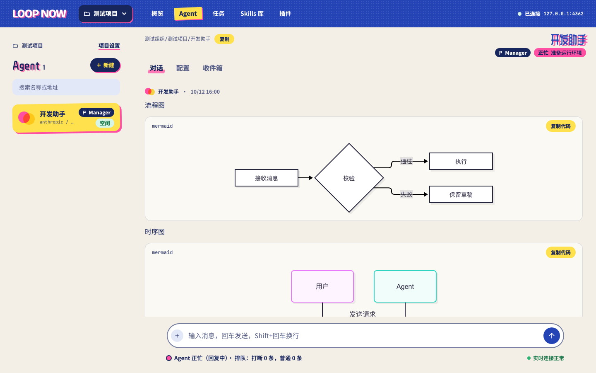
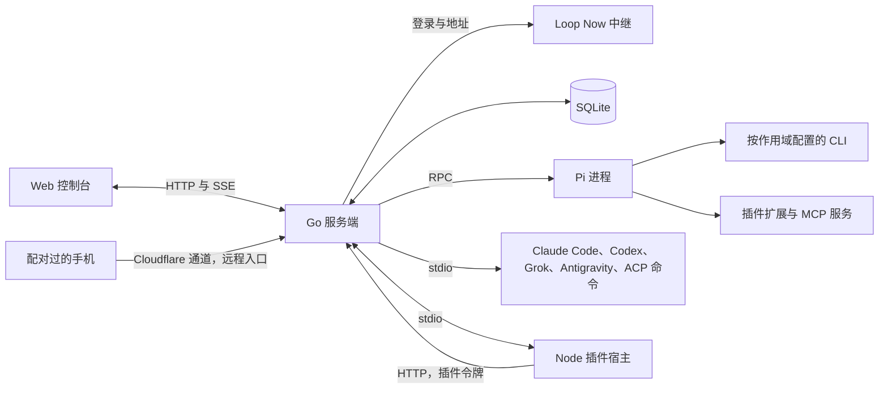

<p align="center">
  
</p>

<h1 align="center">Loop Now</h1>

<p align="center">
  <strong>让多个 AI Agent 在本地协作，用插件扩展它们的能力。</strong><br />
  接入 CLI 与 MCP，订阅事件、编写 Hook，把项目、对话和任务放在一个工作台中。
</p>

<p align="center">
  <a href="README.md">English</a> · <a href="README.zh-CN.md">简体中文</a><br />
  <a href="https://github.com/AI-for-anyone/loop-now/releases/latest">下载桌面版</a> ·
  <a href="#开始使用">开始使用</a> ·
  <a href="#你可以用它做什么">功能</a> ·
  <a href="#核心能力可扩展的插件体系">插件</a> ·
  <a href="https://github.com/AI-for-anyone/loop-now/issues">反馈问题</a>
</p>



<p align="center"><sub>真实控制台，使用演示数据。界面支持中文和英文，按浏览器语言或在设置里切换。</sub></p>

Loop Now 把多个 Agent 的工作放进一个浏览器工作台。每个 Agent 保留自己的工作目录和会话，Manager 可以通过任务流程协调不同角色。你可以随时查看对话、检查工具调用、发消息介入、批准 Agent 请求做的事，并了解谁在执行、谁在等待。

**插件是平台的核心扩展入口**：工具、事件 Hook、账号、权限和资源可以一起打包、安装与管理版本。

平台运行在你的电脑上。每个 Agent 由随包的 [Pi](https://github.com/earendil-works/pi) 运行，或者由这台电脑上已经装好的编程 CLI 运行（Claude Code、Codex、Grok、Antigravity，或任何支持 Agent Client Protocol 的程序），用的是你自己的登录。使用哪些模型、账号、代码仓库和工具，由你为各个 Agent 配置；配对过的手机在哪里都能打开同一个控制台。

> **早期个人版。** 一个人、一台本机服务端。在这台电脑上打开控制台不用登录；手机和其它设备要先配对才能进来。使用模型或工具供应商时，相关数据仍会发送给对应服务。

## 你可以用它做什么

| 能力 | 使用方式 |
| --- | --- |
| **组建 Agent 团队** | 按项目组织 Agent，分别配置运行时和模型、思考等级、Prompt（可以用 **AI 帮写** 起草）、Skills、文件夹与工具权限，并指定 Manager 协调工作。 |
| **用你已有的 CLI** | 让 Agent 跑在 Claude Code、Codex、Grok、Antigravity、你添加的 ACP 命令或随包的 Pi 上。每条消息都可以换，对话会带过去。 |
| **自己把关** | 给每个 Agent 定一个批准模式，从“逐项批准”到“完全放开”；它请求做的事，在回复里、Inbox 里或桌面通知里批准或拒绝。 |
| **保留工作上下文** | 在 Agent 自己的工作区或你指定的文件夹里，持续使用它的常态会话。把 Claude Code 和 Codex 的对话导入进来接着做。CLI 转到后台的工作一直看得见，也能停掉。 |
| **通过 Inbox 协作** | Agent 与人之间可以发消息、提问、回复；忙碌时选择排队或打断，sleep 等待中的 Agent 可被新消息唤醒。 |
| **运行可观察的任务流程** | 查看任务步骤、条件分支、有次数限制的审查回路、在汇合步骤会合的并行分支、重试与成果。任务可以在自己的 git worktree 和分支里干活，也可以在任意文件夹的副本里干活。 |
| **从手机访问** | 用一次性二维码配对手机。这台电脑登录 Loop Now 账号并允许从手机访问后，经 Cloudflare 通道得到 `https://<编号>.loop-now.app`，不用设置路由器。 |
| **用插件扩展能力** | 在同一插件中组合 CLI、MCP、事件 Hook、账号、权限和 Skills，接入团队需要的工具与服务。 |
| **看清执行过程** | 流式阅读回复、发送图片、渲染 Markdown 和 Mermaid，打开 Agent 提到的图片和文件，在每条回复的运行时间线中查看模型用量、工具命令、耗时和失败原因。 |

### 一个例子：从开发到审查

创建 Manager、开发和审查三个 Agent，选好各自由谁来跑、用什么模型和工具，然后对 Manager 说：

> 在 ~/projects/app 里实现这个功能，让审查 Agent 检查，然后开一个 pull request。需要我决定的事情通过 Inbox 提问。

因为请求里指明了仓库，Manager 可以给任务开一个自己的 git worktree 和新分支，你自己的检出不会被动到。任务流程从开发进入审查，也可以在限定次数内返回修改；你能沿途查看每一步的对话、消息和成果。具体开发、QA 或部署流程由项目指令与 Skills 定义，平台不预设某一种业务流程。

## 和 Agent 一起工作

### 谁来跑 Agent

每个 Agent 由一个运行时来跑。新建 Agent 时、在它的配置页上、或在输入框里，用“谁来跑”选择：

| 运行时 | 用的是什么 |
| --- | --- |
| **Pi**（随包） | 你在 Loop Now 里添加的模型账号和 API Key（项目设置 › 模型账号）、[原生 `models.json`](#原生-modelsjson)，以及插件带来的模型提供方 |
| **Claude Code**、**Codex**、**Grok**、**Antigravity** | 这台电脑上安装的 CLI 和你在那里的登录。Loop Now 不读取、也不保存这些登录 |
| **自己添加的 ACP 命令** | 任何支持 Agent Client Protocol 的程序，在 **全局设置 › 运行时与模型** 里添加。它以服务端的用户身份运行，只添加你信任的程序 |

- **全局设置 › 运行时与模型** 显示每个 CLI 是否找到、版本和是否已登录；还没准备好时给出安装或登录的命令。这些命令 Loop Now 不会替你运行。
- 在输入框里选的结果从下一条消息起生效，Agent 正在回复时也可以选。换运行时不会从头开始：新的运行时会拿到已保存的对话（短的全部带上；长的带上你的第一条请求、最近的消息，以及每一轮用了哪些工具的一行摘要，默认最多 16,000 个 token，`LOOP_NOW_CONTEXT_HANDOFF_TOKENS`）。
- **工作文件夹**（配置页 › 工作方式）：跑在 CLI 上的 Agent 可以在你指定的文件夹里干活，而不是在 Loop Now 给它的工作区里。Pi 不行。
- **用我本机的 CLI 配置**（Claude Code 和 Codex）：CLI 像在你的终端里一样运行，用这台电脑的 HOME 和 PATH，以及你自己的 git、gh、ssh 登录；Claude Code 还会用你的设置、`CLAUDE.md`、自动记忆、插件、技能、MCP 服务和它全部的内置工具。打开后项目里的账号不再用于这个 Agent。Codex 不管开不开都会读你的 `~/.codex` 配置。
- **AI 帮写**：每个 Prompt 旁边都有，用这台电脑上的一个 CLI 和它自己的登录起草（**全局设置 › 运行时与模型 › AI 帮写** 决定用哪一个，默认用第一个准备好的）。你保存之前什么都不会保存，也不会新建 Agent。
- **本机模式**（**全局设置 › 工作区与本机模式**）有四个开关，对所有 Agent 生效：“绑定本机目录”把你在项目或 Agent 上登记的本机目录告诉 Agent，“用本机的 git 身份”拉取时用这台电脑的 git 凭证，“用本机的 CLI”让 Agent 能运行这台电脑上装的命令，“用本机的登录状态”让这些工具用你自己的登录。“用本机的登录状态”默认关闭；打开后，Agent 等同以你本人的身份操作。

### 批准模式和批准请求

- 每个 Agent 有一个批准模式：**逐项批准**（运行命令、改文件之前都先问你）、**改文件不用问**、**自动审查**（由 CLI 自己的自动审查放行常规操作，拿不准的再问你）、**完全放开**（什么都不问）。默认是“完全放开”。在输入框或配置页上选；新 Agent 的默认值在 **全局设置 › 常规与外观**。
- 请求出现在发起它的那条回复里，可以批准、拒绝并写理由；Inbox 里和桌面通知里也有，因为没人看着时 Agent 也在跑。停止回复会拒绝还没处理的请求。
- Claude Code 和 Codex 对模式不允许的每个操作都会问。Grok、Antigravity 和 ACP 命令按它们自己的权限规则决定问什么，所以有些命令会直接执行。你添加的 ACP 命令只有“逐项批准”和“完全放开”两种，Pi 只能完全放开。
- 任务里的一步用的是任务开始时它的 Agent 的批准模式。

### 对话

- **导入对话**（**全局设置 › 常规与外观**、空的概览页，或项目的本机目录；全新安装、还没有 Agent 时会自己打开）列出这台电脑上 Claude Code 和 Codex 的对话，按文件夹分组。每个文件夹成为一个项目，每段对话成为一个在那个文件夹里接着做的 Agent，用的是你本机的 CLI 配置。原来的对话不会被改动：Agent 从导入时取的一份副本接着做。
- **后台任务**：Claude Code、Codex、Grok 或 Antigravity 把一条命令或一个子 Agent 转到后台时，回复照 CLI 的方式结束，那份工作一直看得见。输入框下方那一栏里带数字的终端标记打开列表，可以“停止”或“全部停止”。后台工作结束后，Claude Code、Grok 或 Antigravity 自己接着回复时，这条回复单独显示；Codex 不会自己接着回复。
- **回复里的图片和文件**：Agent 放进回复的图片，或用它文件夹里的路径提到的图片，显示成可以点开的缩略图。它提到的其它文件显示成卡片，在沙箱化的新标签页里打开（桌面版里用系统浏览器打开）。文件夹外的路径仍是普通文字。
- **命令**：在输入框里输入 `/` 列出内置的会话命令（`/session`、`/new`、`/compact`、`/reload`、`/copy`、`/export`、`/resume`；哪些能用取决于运行时），在 Pi 上还有它的扩展和 Skills 带来的命令，写作 `/pi:<名称>`。
- 因为退出或崩溃而中断的回复会被记住：下一次 Agent 知道自己做过什么、停在哪里。

### 任务：流程、工作区和并行步骤

- 让项目的 Manager 去做一件事，它会建一个任务：一个固定的流程，由若干步骤组成，每一步由一个 Agent 完成，支持条件分支、有次数限制的审查回路、重试和成果保存。任务开始时流程和各 Agent 的配置就固定下来。任务页显示流程、每一步的对话和成果。
- **干净开始**：Agent 在任务里的工作从一段干净的对话开始，带着它的 Prompt、指令文件和记忆、任务请求，以及 Manager 为这一步写的 Prompt（任务页上的“节点 Prompt”），但不带它常态对话的聊天记录；它在这个任务里自己的各个步骤之间沿用这段任务对话。真的需要聊天记录的步骤可以要一份副本（标为“带聊天记录”）。建任务不用等忙着的 Agent。
- **工作区**：Manager 可以为任务指定这台电脑上的一个文件夹。git 仓库里的文件夹会得到一个自己的 worktree 和一个新分支，从远端默认分支开出（默认叫 `task/<编号>-<标题>`，Manager 也可以自己起名）；Agent 自己提交、推送并开 pull request。其它文件夹会为任务复制一份，只读不写；成果保存为任务成果。同一个文件夹上可以同时跑好几个任务。结束时，只有不会丢东西，Loop Now 才删掉 worktree 或副本；它从不在你自己的检出里切分支或清理文件。
- **并行步骤**：一步可以分叉成几个同时运行的分支，在汇合步骤会合；所有分支都到了，汇合步骤才开始。git 任务里每个分支在自己的 worktree 和分支上干活，汇合时合并回任务分支（有冲突交给汇合步骤的 Agent 解决）；复制文件夹的任务里每个分支有自己的副本，不会合并回去。分叉不能嵌套。

### 手机和其它设备

都在一个页面上，**全局设置 › 手机和其它设备**，只有这台电脑能改：

1. **登录 Loop Now 账号**。浏览器里会打开 Loop Now 中继（`relay.loop-now.app`）的登录页。要从手机访问，先得登录。
2. **允许从手机访问**。第一次打开时，Loop Now 在中继登记这台电脑，这台电脑由此得到自己的地址 `https://<编号>.loop-now.app`。关掉访问或退出登录，地址仍为它保留；点“释放地址”就放弃这个地址（换一个账号登录也一样），下次打开会拿到新地址。Loop Now 运行 `cloudflared`（用你 `PATH` 上的，或者下载固定版本并核对），从这台电脑向外保持一条 Cloudflare 通道，连到远程入口，也就是 `127.0.0.1` 上的第二个监听。不用设置路由器；崩溃或重启后通道会自己恢复。
3. **添加设备**。二维码和链接里带着一个一次性配对码，10 分钟内有效；在手机上打开就配对好了。页面列出已配对的设备，可以立即移除；30 天没用过的设备要重新配对。控制台可以添加到手机主屏幕。

手机发来的请求先经 HTTPS 到达 Cloudflare，和它代理的任何网站一样，Cloudflare 的边缘节点会解密这些请求，再经这条通道到达这台电脑。中继只负责这台电脑的登录，以及开好它的地址和通道（在 Cloudflare 上的 DNS 记录和通道）；你的对话和设备登录都不经过中继。这台电脑要一直运行 Loop Now：关掉桌面版窗口它仍在运行，退出就停了，这时手机会提示连不上。没有账号时也可以打开远程入口，但只有这台电脑能连上。详见[配置 › 手机和其它设备](https://ai-for-anyone.github.io/loop-now/zh/reference/configuration#phones-and-other-devices)。

## 核心能力：可扩展的插件体系

**新工具与项目特有的行为都放进插件**。一个插件就是一个目录，`package.json` 是它唯一的清单。插件最多有两侧，任一侧都可以没有：

- **Agent 侧**是标准的 [Pi 包](https://pi.dev/packages)：Pi 扩展、Skills、MCP 服务器和 CLI。每个获得授权的 Agent 在自己的 Pi 进程里加载它。现成的 Pi 包不用改就能装。
- **平台侧**运行在服务端旁边一个常驻的 Node 插件宿主里，订阅平台事件，并用按权限签发的插件令牌调用平台接口。

跑在 Claude Code、Codex、Grok 或 Antigravity 上的 Agent 能用授权给它的插件里的 Skills 和 MCP 服务；Pi 扩展以及它们带来的模型提供方只在 Pi 上加载。

| 宿主提供 | 对插件意味着什么 |
| --- | --- |
| **事件** | 事件目录里的全部观察类事件：执行轮次、任务、节点、收件箱、提问、sleep、Agent、Pi 进程、上下文文件夹、插件自身。事件先持久化，处理函数返回后才确认，失败重投，重启后续投。拦截、修改、认领类 Hook 各有超时和超时策略。 |
| **状态与密钥** | 每个插件有自己的持久状态，分全局与项目级。`x-secret` 配置字段在控制台只写不回显，并在插件日志里遮蔽。 |
| **配置表单** | `loopNow.configSchema` 就是 JSON Schema，控制台据此生成表单；标了 `x-scope: project` 的字段可以按项目覆盖。 |
| **可靠的外发 HTTP** | SDK 的投递库带持久队列和退避重试，用 HMAC-SHA256 签名，并写下投递记录，插件页直接展示。 |
| **日志与隔离** | 每个插件的输出进入它自己的日志。一个插件抛错、超时或加载失败，只影响它自己。 |

清单说了算：订阅清单没有声明的事件、调用清单之外的接口范围都会失败。安装前，平台会把两侧各有什么、订阅哪些事件、要哪些权限展示给人看。

观察类事件、状态、密钥、配置和投递库已经可用。拦截与修改 Hook、控制台操作按钮、HTTP 入口、定时、渠道和插件账号已在 [`plugins/SPEC.md`](plugins/SPEC.md) 定稿，正在陆续上线。

### 平台安装，项目启用，Agent 授权

可以从官方插件、Git 仓库、npm 包或本机目录安装，在控制台里操作，或用 `loopctl plugin install`。装好后，先在项目里启用插件并填写配置，再授权给需要加载 Agent 侧的 Agent。安装或启用本身不会给任何 Agent 授权。版本是固定的：更新是显式操作，进行中的任务继续用启动时的文件。

Pi 扩展还可以带来自带订阅登录的模型提供方，比如插件市场里的社区扩展 pi-grok-cli：把插件授权给 Agent，在项目设置 › 模型账号里登录（不属于任何项目的 Agent 在它自己的页面上登录），再在 Agent 配置里选这个提供方。

随平台发布三个官方插件：

- [**webhook**](plugins/official/webhook/README.md)：收件箱收到消息时，签名后 POST 到你的地址，失败重试，并记下投递记录。外部身份用它代替轮询收件箱。
- [**playwright**](plugins/official/playwright/README.md)：给 Agent 一个专用的可见 Chromium，通过官方 Playwright MCP 打开网页、读取页面、点击、输入和截图，不连接你的日常 Chrome。
- [**hello**](plugins/official/hello/README.md)：两侧齐全的最小插件，可以从它开始写自己的插件。

### 几行代码写出平台侧

```ts
import { createDelivery, type PluginAPI } from '@loop-now/plugin-sdk'

export default function register(api: PluginAPI) {
  const delivery = createDelivery(api)
  api.on('task.completed', async (event) => {
    const { url } = api.config.get<{ url?: string }>(event.projectId)
    if (url) await delivery.deliver({ target: url, body: event, eventId: event.id, eventType: event.type })
  })
}
```

```json
{
  "name": "task-notifier",
  "version": "1.0.0",
  "keywords": ["loop-now-plugin"],
  "peerDependencies": { "@loop-now/plugin-sdk": "*" },
  "loopNow": {
    "id": "task-notifier",
    "platform": "./platform.ts",
    "events": ["task.completed"],
    "permissions": ["state"],
    "configSchema": { "type": "object", "properties": { "url": { "type": "string", "x-scope": "project" } } }
  }
}
```

宿主和 Pi 一样直接加载 TypeScript，并自己提供 `@loop-now/plugin-sdk`。用 `node plugins/host/dist/main.js validate <目录> --load` 检查目录：它报出清单错误，以及代码里超出 `loopNow.events` 的订阅。

入门先看 [SDK 说明](plugins/sdk/README.md) 和官方插件。[`plugins/SPEC.md`](plugins/SPEC.md) 是完整合同，包括包格式、事件目录、Hook 种类与超时、权限和安装流程；[`api/plugin-host-protocol.md`](api/plugin-host-protocol.md) 是服务端与宿主之间的通信协议。平台不做沙箱：插件会执行代码，只安装可信来源。

飞书用户身份执行另需[构建说明](scripts/lark-user-variant/README.md)中固定版本的平台发行包；普通对话不需要它。

## 开始使用

四种方式：**桌面版**（macOS，什么都不用装）、**服务端发行包**（Linux、macOS）、**Docker Compose** 一体化启动、从源码安装。主要验证环境是 macOS Apple Silicon；部分组件支持 Linux，但尚未完成同等范围的整套验证。飞书用户 CLI 运行组件目前仅支持 macOS arm64。

### 桌面版（macOS Apple Silicon）

一个 DMG 里带着服务端、控制台、Node 和 Pi，不需要另装任何东西。目前只发布这个 macOS Apple Silicon 版本，还没有 Windows 或 Linux 桌面版。

1. 从 [Releases](https://github.com/AI-for-anyone/loop-now/releases/latest) 下载 `loop-now-desktop-<版本>-mac-arm64.dmg`，打开后把 Loop Now 拖进"应用程序"。
2. 第一次打开：安装包目前没有 Apple 公证，macOS 会提示无法验证开发者。到"系统设置 › 隐私与安全性"，在"安全性"一栏点"仍要打开"，之后不再提示。
3. 启动后菜单栏出现 Loop Now 图标，窗口里就是控制台。关掉窗口，服务端和 Agent 仍在后台运行；要彻底停止，从菜单栏图标选“退出 Loop Now”。

菜单栏图标显示服务端的状态和正在用的配置，并提供“打开窗口”“在默认浏览器打开”“查看日志”“安装命令行工具…”“外部身份连接方式…”和“重启服务”。

数据在哪：数据库和每日备份在 `~/Library/Application Support/Loop Now/default/data`，Agent 工作区在 `/Users/Shared/loop-now-desktop/default`，日志在 `~/Library/Logs/Loop Now/default`。桌面版默认不使用源码安装的 `~/.loop_now` 和 `/Users/Shared/loop-now`，两种安装可以并存。要用一套独立的数据试用，带参数启动：`open -a "Loop Now" --args --profile=trial`。从源码安装迁移过来、想沿用原来的工作根：先停掉源码安装的服务端并退出 Loop Now，在 `~/Library/Application Support/Loop Now/desktop.json` 里写上 `{"profiles": {"default": {"workRoot": "/Users/Shared/loop-now"}}}`（`dataDir`、`contextDir` 也可以这样指定，都写绝对路径），再打开；菜单栏图标里的配置一行会显示实际用的路径。基于 PostgreSQL 的安装还要先导入数据库，完整步骤见[快速上手](https://ai-for-anyone.github.io/loop-now/zh/guide/getting-started#moving-to-the-desktop-app)。

更新：退出 Loop Now，用新的 DMG 替换"应用程序"里的 app，再打开，数据保留。应用会自己检查新版本（启动后不久一次，之后每 6 小时一次）；有新版本时，菜单栏图标里会出现“有新版本 …，去下载…”，点它打开下载页。签名公证完成后才会改为自动安装。

桌面版带着 Pi 1.4.0 和 Node 24.21；跑在 Claude Code、Codex、Grok 或 Antigravity 上的 Agent 用这台 Mac 上安装的 CLI。模型账号、CLI 账号、插件都在控制台里配置，和源码安装相同。第一次打开时，Loop Now 会提示一次是否在终端安装 `loopctl` 命令行工具（macOS 会要一次管理员密码）；之后随时可以从菜单栏图标 › “安装命令行工具…” 或 **全局设置 › 常规与外观 › 命令行工具 loopctl** 安装，那一行会显示是否已经装好。外部身份和 `loopctl` 用的对外 TLS 端口桌面版会自动开在本机（`127.0.0.1`，证书由服务端自动维护）；菜单栏图标 › “外部身份连接方式…” 会显示地址、证书路径和 `loopctl` 配置命令。

### 服务端发行包（Linux / macOS）

每个版本在 Releases 里还有各平台的服务端发行包 `loop-now-<版本>-<平台>.tar.gz`，平台有 `darwin-arm64`、`darwin-amd64`、`linux-amd64`、`linux-arm64`。包里有内嵌控制台的 `loop-server`、`loopctl`、插件宿主、官方插件，以及随包的 Node 24.21.0 和 Pi 1.4.0，机器上只需要有 Git。

1. 从 [Releases](https://github.com/AI-for-anyone/loop-now/releases/latest) 下载对应平台的包和 `SHA256SUMS`，校验下载：

   ```sh
   sha256sum -c --ignore-missing SHA256SUMS        # Linux
   shasum -a 256 -c --ignore-missing SHA256SUMS    # macOS
   ```

2. 在终端里用 `tar` 解开。macOS 上如果在访达里解开，文件会被标记为来自互联网，未签名的程序会被 Gatekeeper 拦下。

   ```sh
   tar -xzf loop-now-<版本>-<平台>.tar.gz
   cd loop-now-<版本>-<平台>
   ```

3. 设置数据目录和工作根后启动服务端。工作根的要求和创建方法与源码安装相同（见[第 2 步](#2-配置服务端)）：

   ```sh
   export LOOP_NOW_DATA_DIR="$HOME/.loop_now"
   export LOOP_NOW_WORK_ROOT='/var/lib/loop-now'   # macOS 用 /Users/Shared/loop-now
   ./loop-server
   ```

4. 打开 **[http://127.0.0.1:8780/](http://127.0.0.1:8780/)**。控制台就在服务端口的根路径，不需要另起控制台。

随包的 Node 和 Pi 会自动使用，不用另装；设置了 `LOOP_NOW_NODE_BIN` 等变量时仍以变量为准。凭证以明文保存在数据目录里，请保护好数据目录和备份。升级时停掉服务端，解开新版本的包，用同样的 `LOOP_NOW_DATA_DIR` 和 `LOOP_NOW_WORK_ROOT` 启动新目录里的 `loop-server`，然后删掉旧目录。


### Docker Compose（本地一体化）

首次启动会在本机构建服务端和控制台镜像，并启动这两者：

```sh
docker compose up --build -d
```

打开 **[http://localhost:5173](http://localhost:5173)**。本机控制台没有登录功能，因此 Compose 只把 Web 的 `5173` 和 API 的 `8780` 发布到 `127.0.0.1`，不要把这套配置暴露到外部。

`loopdata` 命名卷保存数据库（SQLite，含每日备份）、Agent 工作区、会话和工具。`docker compose down` 会保留它们；`docker compose down -v` 会删除这些数据，执行前请先备份。

容器中的 Agent 有一些边界：

- 飞书用户 CLI 只支持 macOS arm64，不能在这套 Linux 容器里使用。
- 容器不会自动看到宿主机目录。已有仓库或资料需要另外挂载到 `server` 容器，并在控制台配置挂载后的容器内路径；`loopdata` 只保存平台自己的工作区。
- 容器不会共享宿主机上已经登录的 Pi 或 CLI 会话。请预先在项目中配置模型 API Key 和所需工具账号。
- 服务端镜像里只有 Pi：没有装 Claude Code、Codex、Grok 和 Antigravity，所以容器里的 Agent 都由 Pi 来跑。

### 原生 models.json

在“全局设置 › 运行时与模型 › models.json”中可以编辑固定版本 Pi 的原生 `models.json`，添加自定义 Provider 或覆盖内置 Provider。例如：

```json
{
  "providers": {
    "example": {
      "baseUrl": "https://models.example.com/v1",
      "api": "openai-completions",
      "apiKey": "$EXAMPLE_KEY",
      "headers": { "X-Client": "$EXAMPLE_CLIENT_HEADER" },
      "models": [
        { "id": "my-model", "input": ["text", "image"], "contextWindow": 128000, "maxTokens": 8192 }
      ]
    }
  }
}
```

`apiKey` 以及 Provider、模型和模型覆盖中的 `headers` 值只接受 `$NAME` 形式的环境变量引用；变量名由英文字母或下划线开头，后接字母、数字或下划线。不要填写明文密钥或 `!命令`。真实密钥仍在项目的模型账号中配置，不会写进 `models.json` 或回显到编辑器。

保存后，常态 Agent 从下一条消息使用新目录，已启动任务继续使用创建时冻结的 Provider 配置。如果重启后已保存配置不再通过当前 Pi 校验，服务会暂时退回内置模型目录，并在设置页显示警告，让你仍能修正并重新保存。

### 源码安装：1. 准备依赖

| 依赖 | 仓库当前版本基线 |
| --- | --- |
| Go | 1.27 或以上 |
| Node.js / npm | **24.21.0 / 11.19.0**；Web 脚本会检查精确版本 |
| Pi coding agent | **1.4.0** |
| 其他工具 | Git |

切换到要求的 Node 和 npm 后：

```sh
npm install -g @earendil-works/pi-coding-agent@1.4.0
pi --version

git clone --depth 1 --branch main https://github.com/AI-for-anyone/loop-now.git
cd loop-now
```

### 2. 配置服务端

以下命令在仓库根目录运行：

```sh
export LOOP_NOW_NODE_BIN="$(command -v node)"
export LOOP_NOW_PI_BIN="$(command -v pi)"
```

服务端把数据库和每日备份放在数据目录里，默认是服务进程用户主目录下的 `~/.loop_now`（用 `LOOP_NOW_DATA_DIR` 修改），首次启动时自动建库。凭证以明文存在这个数据库里，请保护好数据目录和备份。服务端从进程环境变量读取配置，不会自动加载 `.env` 文件。

执行工作根目录必须持久保存，并位于**用户主目录之外**，它和上级目录不能包含 `AGENTS.md` 或 `CLAUDE.md`，以免 Pi 继承宿主上无关的指令。新安装默认使用 macOS 的 `/Users/Shared/loop-now`，或 Linux 的 `/var/lib/loop-now`：

```sh
# macOS；Linux 改用 /var/lib/loop-now。
export LOOP_NOW_WORK_ROOT='/Users/Shared/loop-now'
sudo mkdir -p "$LOOP_NOW_WORK_ROOT"
sudo chown "$(id -u):$(id -g)" "$LOOP_NOW_WORK_ROOT"
chmod 700 "$LOOP_NOW_WORK_ROOT"
```

### 3. 构建并启动后端

服务端和配套 `loopctl` 必须使用同一版本构建：

```sh
mkdir -p bin
go build -o bin/loop-server ./cmd/loop-server
loop_version="$(bin/loop-server version)"
go run ./cmd/loopctl-dist -version "$loop_version" -out "$PWD/.local-build/loopctl-dist"

export LOOP_NOW_LOOPCTL_DIST_DIR="$PWD/.local-build/loopctl-dist"
bin/loop-server
```

启动时会检查依赖、执行待应用的数据库迁移，并创建默认组织和项目。API 监听 `127.0.0.1:8780`。一个数据目录同时只能由一个服务端使用；更新时保留数据目录和工作目录。从基于 PostgreSQL 的版本（到 v0.1.0 为止）迁移过来时，先检出 tag `pg-final`（PostgreSQL 版的最后一个提交），构建并启动一次，让旧库完成最后的迁移，停掉服务，然后把 `LOOP_NOW_DATABASE_URL` 指向旧库，运行一次 `loop-server import-postgres`，它会把全部数据复制到数据目录里的新库。

插件需要 Node 插件宿主，从 `plugins/` 构建（Node 24.21.0）。设置了 `LOOP_NOW_PLUGIN_HOST_ENTRY` 时服务端才运行它；设置了 `LOOP_NOW_PLUGIN_OFFICIAL_DIR` 时，官方插件作为 `builtin` 安装来源提供：

```sh
(cd plugins && npm ci --ignore-scripts && npm run build)
export LOOP_NOW_PLUGIN_HOST_ENTRY="$PWD/plugins/host/dist/main.js"
export LOOP_NOW_PLUGIN_OFFICIAL_DIR="$PWD/plugins/official"
```

在启动 `bin/loop-server` 之前设置好。`dist/main.js` 是一个自带全部依赖的文件，可以复制到别处。可选工具集成可能还需要各自的依赖和凭证。

### 4. 启动控制台

打开第二个终端，从仓库根目录运行，确保当前 Node 为 24.21.0、npm 为 11.19.0：

```sh
cd web
export LOOP_NOW_WEB_NODE_BIN="$(dirname "$(command -v node)")"
./bin/npm24 ci
./bin/npm24 run dev
```

访问 **[http://localhost:5173](http://localhost:5173)**。默认 API 地址已配置好；需要修改时参见 [`web/.env.example`](web/.env.example)。

### 5. 给第一个 Agent 安排工作

1. 创建 Agent，选好谁来跑。这台电脑上已经装好并登录的 CLI 可以直接用；用 Pi 的话，先在项目设置里通过支持的登录方式或 API Key 添加模型账号。已经有 Claude Code 或 Codex 的对话？用 **导入对话** 把它们变成 Agent。
2. 写好它的 Prompt（或者让 **AI 帮写** 起草），添加 Skills。
3. 指定工作文件夹，或添加需要的仓库和资料，并选好批准模式。启用插件，并明确授予工具权限。
4. 开始对话。发送图片时，选择支持图片输入的模型。
5. 需要协作时，再添加不同角色的 Agent，并指定项目 Manager。

建议先让一个 Agent 完成小任务，再组合较长的工作流。

## 系统如何组成



数据目录里的 SQLite 保存平台状态、凭证、消息、任务记录和排队；忙闲锁和实时流在服务端进程内，本地文件系统保存 Agent 工作目录、会话、任务的 worktree 和副本，以及已安装工具。每个 Agent 的回合在 Pi 进程里跑，或在它所用的 CLI 里跑；这些 CLI 的对话记录和登录仍在它们原来的位置。这些组件组成一套本地安装，图中拆分不代表已经支持独立扩缩容。

| 目录 | 用途 |
| --- | --- |
| [`web/`](web/) | React、TypeScript、Vite 控制台 |
| [`internal/server/`](internal/server/) | Go API、调度、存储和本机执行器 |
| [`cmd/loopctl/`](cmd/loopctl/) | 平台 Agent 与外部身份使用的 JSON CLI |
| [`plugins/`](plugins/) | 插件规范、Node 插件宿主、SDK 与官方插件 |
| [`api/`](api/) | 控制台与 Agent 的 OpenAPI 契约 |
| [`MAIN.md`](MAIN.md) | 维护者项目概览与当前实现状态 |

## 配置与当前边界

全部服务端配置和默认值见 [`internal/server/config/config.go`](internal/server/config/config.go)，常用项包括：

| 环境变量 | 用途／默认值 |
| --- | --- |
| `LOOP_NOW_LISTEN_ADDR` | 控制台 API；默认 `127.0.0.1:8780` |
| `LOOP_NOW_DATA_DIR` | 数据库（`db/`）和每日备份（`backups/`）；服务进程用户的 `~/.loop_now` |
| `LOOP_NOW_WORK_ROOT` | 持久化 Agent 工作目录与运行文件 |
| `LOOP_NOW_CONTEXT_DIR` | 项目（`projects/<id>/`）与全局（`global/`）上下文文件夹；默认服务运行用户的 `~/.loop_now` |
| `LOOP_NOW_PLUGIN_HOST_ENTRY` | 插件宿主入口的绝对路径（用 Node 运行）；不设时插件的平台侧不运行 |
| `LOOP_NOW_PLUGIN_OFFICIAL_DIR` | 随平台发布的官方插件目录的绝对路径（每个插件一个子目录）；不设时没有 `builtin` 安装来源 |
| `LOOP_NOW_PLUGIN_MARKET_URL` | 官方插件市场 `loop-now-market.json` 的 `https` 地址；默认是官方市场的索引地址，可改成别的地址 |
| `LOOP_NOW_PI_MAX_PROCESSES` | `0` 表示不限；正数限制本机 Pi 进程数 |
| `LOOP_NOW_PI_IDLE_TIMEOUT` | Pi 空闲退出时间；默认 `10m` |
| `LOOP_NOW_CONSOLE_ORIGINS` | 允许跨源调用 API 的浏览器来源，给 Vite 开发服务器用；默认本机 5173 端口。服务端自己提供的控制台是同源的，不用写进来 |
| `LOOP_NOW_CONTEXT_HANDOFF_TOKENS` | Agent 换运行时时，新的运行时最多拿到多少已保存的对话；默认 `16000` |
| `LOOP_NOW_RELAY_URL` | 账号和通道用的 Loop Now 中继；默认 `https://relay.loop-now.app` |
| `LOOP_NOW_CLOUDFLARED_PATH` | 通道要运行的 `cloudflared`；不设时先在 `PATH` 上找，找不到再下载固定版本 |
| `LOOP_NOW_LARK_USER_BUNDLE_DIR` | 可选的已验证飞书用户 CLI 发行包 |

当前版本面向可信的个人使用环境：

- 在这台电脑上打开控制台不用登录，请保留回环监听，不要暴露到网络上。其它设备只能从远程入口进来，那里的每个请求都要求设备已经配对；见[手机和其它设备](#手机和其它设备)和[配置 › 手机和其它设备](https://ai-for-anyone.github.io/loop-now/zh/reference/configuration#phones-and-other-devices)。
- Agent 使用服务端的操作系统用户执行本地命令，任务目录、worktree 和批准模式都不等于操作系统安全沙箱。用本机 CLI 配置的 Agent，或打开了“用本机的登录状态”时，Agent 等同以你本人的身份操作。
- 插件和你添加的 ACP 命令会执行代码，应只安装可信来源。模型和工具能访问什么，也取决于你提供的凭证与权限。
- 工作流支持线性步骤、条件分支、有次数限制的回路，以及在汇合步骤会合的并行分支（不能嵌套）；多副本部署和弹性伸缩不属于当前个人版范围。
- 会话记录会持久保存，但服务端重启不代表执行能无缝继续，也不保证自动重放进行中的工作；宜在 Agent 空闲时更新。

## 参与贡献

欢迎问题反馈、小范围修复、插件集成和文档改进。较大的行为改动请先开 [Issue](https://github.com/AI-for-anyone/loop-now/issues) 对齐范围。

先阅读 [`AGENTS.md`](AGENTS.md) 和 [`MAIN.md`](MAIN.md)，保持改动聚焦，并运行与改动相关的检查：

```sh
# 后端，在仓库根目录运行
go vet ./cmd/... ./internal/... ./api/...
go run ./scripts/check-english
go test ./cmd/... ./internal/... ./api/...

# Web，在 web/ 中运行，沿用上文的 Node 路径设置
./bin/npm24 run typecheck
./bin/npm24 run api:check
./bin/npm24 run lint
./bin/npm24 run check:text
./bin/npm24 test
./bin/npm24 run build
```

后端测试不需要外部服务，每个测试使用自己的临时数据目录；只有一次性 PostgreSQL 导入器的测试需要通过 `LOOP_NOW_TEST_DATABASE_URL` 指向测试库。原生和浏览器测试有各自的夹具要求，跳过不等于集成验证通过。请勿在贡献中提交凭证、本地运行数据或构建产物。

## 许可证

Copyright 2026 Loop Now contributors.

Loop Now 采用 [Apache License 2.0](LICENSE)。仓库内第三方代码与字体保留各自的许可证和声明。
