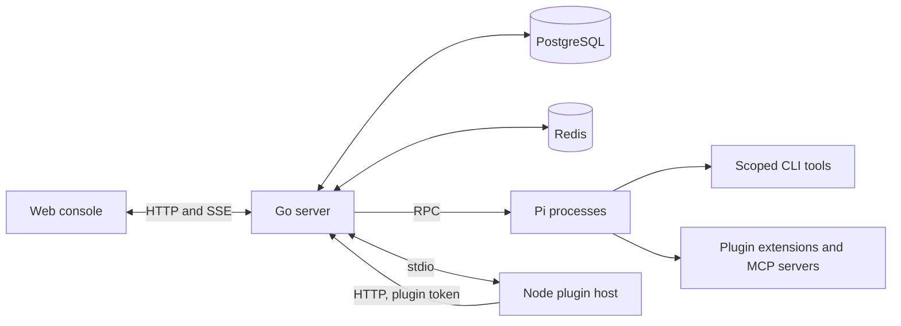

# Architecture

Loop Now is one **local installation**: a Go server, a React console, a PostgreSQL database, Redis, per-agent Pi processes, and a shared Node plugin host. The components below form a single working system; the diagram does not imply independently scalable services.

- **PostgreSQL** stores platform state, credentials, messages, and task records.
- **Redis** handles coordination, queues, and live streams.
- **The local filesystem** holds agent workspaces, sessions, and installed tools.
- **Pi processes** execute the agents' turns. Each agent runs in its own working directory; the server launches, recycles, and bounds them.
- **The plugin host** runs platform halves in one long-lived Node process, talks to the server over stdio JSON-lines, and calls back over HTTP with scoped plugin tokens.

## Repository map

| Source | Purpose |
| --- | --- |
| [`web/`](https://github.com/AI-for-anyone/loop-now/tree/main/web/) | React, TypeScript, and Vite console |
| [`internal/server/`](https://github.com/AI-for-anyone/loop-now/tree/main/internal/server/) | Go API, scheduling, storage, and local execution |
| [`cmd/loopctl/`](https://github.com/AI-for-anyone/loop-now/tree/main/cmd/loopctl/) | JSON CLI for platform agents and external identities |
| [`plugins/`](https://github.com/AI-for-anyone/loop-now/tree/main/plugins/) | Plugin specification, Node plugin host, SDK, and official plugins |
| [`api/`](https://github.com/AI-for-anyone/loop-now/tree/main/api/) | Console and Agent OpenAPI contracts |
| [`MAIN.md`](https://github.com/AI-for-anyone/loop-now/blob/main/MAIN.md) | Maintainer overview and current implementation state |

## Execution flow

1. You talk to an agent (or a Manager) in the console. The server persists the message and queues the work.
2. The server launches or reuses a Pi process for that agent, inside its working directory — the regular directory, or a task clone.
3. Pi streams the reply; tool calls, commands, and usage flow back through the server to the console and into the run timeline.
4. Agents coordinate through the Inbox: queued or interrupting messages, questions that pause a node, sleep that can be woken early.
5. Tasks follow their frozen workflow node by node; artifacts and records stay after execution resources are recycled.

## Boundaries of this edition

- Linear steps, conditional branches, and bounded loops — no parallel joins, multi-replica deployment, or elastic scaling.
- One server per installation; the console is loopback-only and has no login.
- Conversation history is persistent, but a server restart is not a promise of uninterrupted execution or automatic replay of in-flight work. Prefer updating when agents are idle.

See [Configuration](/reference/configuration) for the environment variables that shape a deployment, and [Plugin system overview](/plugins/) for how extensions fit into this picture.
