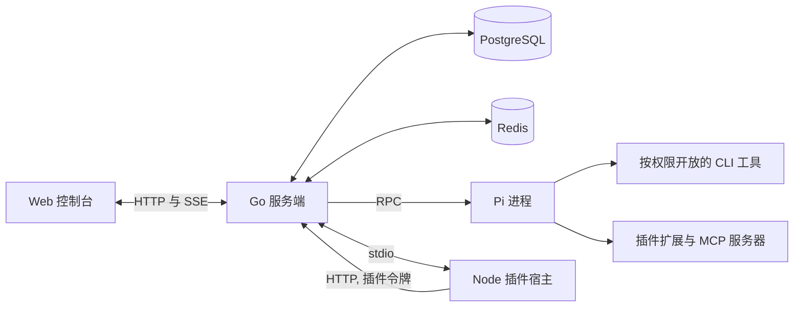

# 架构

Loop Now 是**一个本地安装**：一个 Go 服务端、一个 React 控制台、一个 PostgreSQL 数据库、Redis、按 Agent 划分的 Pi 进程，以及一个共享的 Node 插件宿主。下图的组件构成一个完整的工作系统，并不代表可独立扩展的服务。

- **PostgreSQL** 保存平台状态、凭证、消息和任务记录。
- **Redis** 负责协调、队列和实时事件流。
- **本地文件系统** 保存 Agent 工作区、会话和已安装的工具。
- **Pi 进程** 执行 Agent 的每一轮工作。每个 Agent 在自己的工作目录中运行；服务端负责拉起、回收和限制它们。
- **插件宿主** 在一个常驻 Node 进程中运行各插件的平台半边，通过 stdio JSON 行协议与服务端通信，并用按权限签发的插件令牌以 HTTP 回调平台接口。

## 仓库地图

| 源码 | 用途 |
| --- | --- |
| [`web/`](https://github.com/AI-for-anyone/loop-now/tree/main/web/) | React、TypeScript 与 Vite 控制台 |
| [`internal/server/`](https://github.com/AI-for-anyone/loop-now/tree/main/internal/server/) | Go API、调度、存储与本地执行 |
| [`cmd/loopctl/`](https://github.com/AI-for-anyone/loop-now/tree/main/cmd/loopctl/) | 面向平台 Agent 与外部身份的 JSON CLI |
| [`plugins/`](https://github.com/AI-for-anyone/loop-now/tree/main/plugins/) | 插件规范、Node 插件宿主、SDK 与官方插件 |
| [`api/`](https://github.com/AI-for-anyone/loop-now/tree/main/api/) | 控制台与 Agent 的 OpenAPI 契约 |
| [`MAIN.md`](https://github.com/AI-for-anyone/loop-now/blob/main/MAIN.md) | 维护者概览与当前实现状态 |

## 执行流程

1. 你在控制台与一个 Agent（或 Manager）对话。服务端持久化消息并排队工作。
2. 服务端为该 Agent 启动或复用一个 Pi 进程，运行在它的工作目录中——常态目录或任务克隆。
3. Pi 流式输出回复；工具调用、命令和用量经服务端回到控制台，进入运行时间线。
4. Agent 之间通过 Inbox 协作：排队或打断的消息、让节点暂停的提问、可被提前唤醒的 sleep。
5. 任务按冻结的流程逐节点执行；产物和记录在执行资源回收后保留。

## 本版本的边界

- 支持线性、条件分支和有次数限制的回路——不支持并行汇合、多副本部署和弹性伸缩。
- 每个安装运行一个服务端；控制台仅本机回环、无登录。
- 对话历史是持久的，但服务端重启不保证执行不间断、也不自动重放在途工作。建议在 Agent 空闲时升级。

环境变量的完整说明见[配置项](/zh/reference/configuration)；扩展如何融入这套架构见[插件体系概览](/zh/plugins/)。
